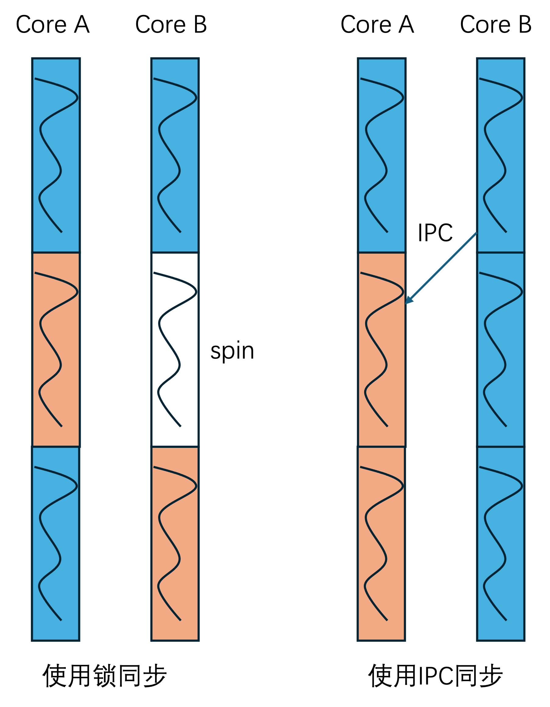
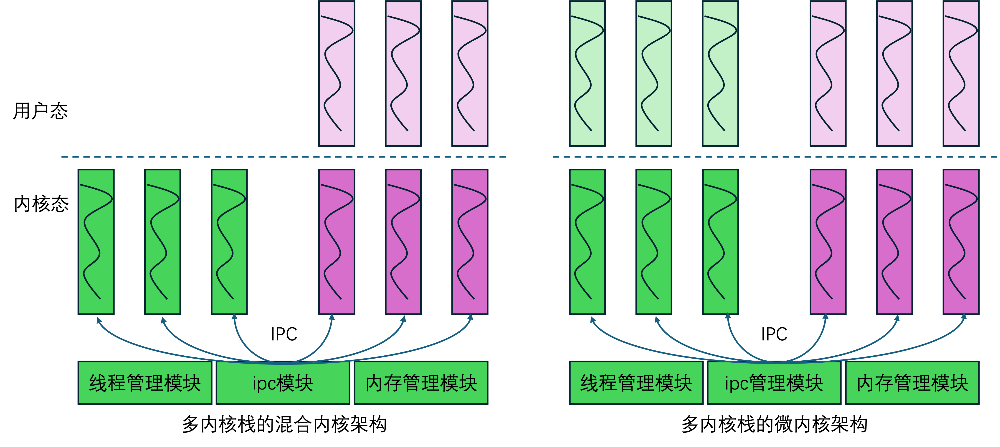
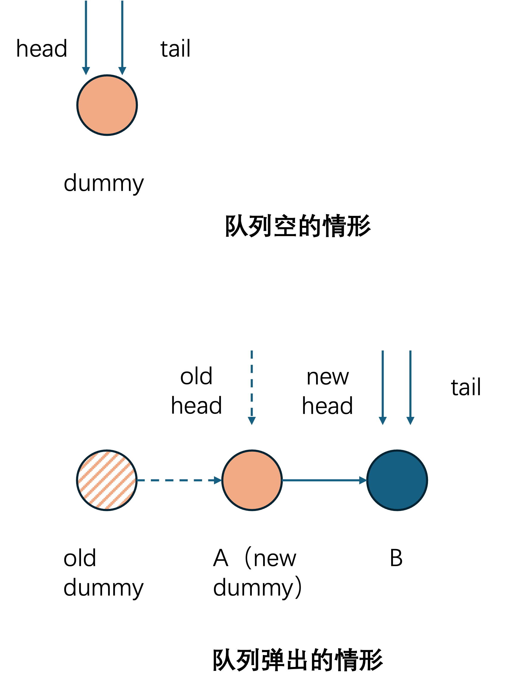
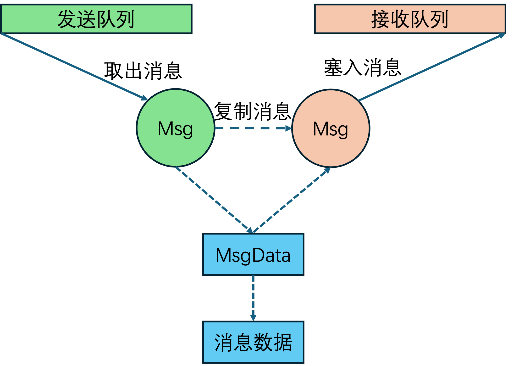

# 支持 IPC 的无锁 MSQ 队列实现

v0.1 · 2026-10-02

本篇覆盖：`include/common/dsa/ms_queue.h`、`include/common/taggedptr.h`；以及 IPC / message 路径上 **如何使用** EBR（`kernel/task/ebr.c`）。`ipc.c` / `message.c` 的对象与收发契约分别以 Port 篇、收发篇为准——本篇只写「在队列算法约束下对他们的影响」。

EBR 机制与「谁推进 reclaim」见 `03-任务与调度/17-EBR与线程资源回收.md`：`schedule()` 每次切线程会调 `ebr_try_reclaim()`；线程 teardown 同步释放 `Thread_Base` 本身，但排空其 send/recv 队列时会对 `Message_t` / `Ipc_Request` 走 `ebr_retire_ref`。Port 对象相关见 `19`；会合收发见 `20`；tagged pointer 位布局见本篇 §4.2（源码 `taggedptr.h`）。

### 在 04-IPC 章里怎么读

| 读什么 | 钉什么 |
|--------|--------|
| 本篇 **§1.1–1.2** | 锁与IPC 同构、基于IPC的混合内核和微内核框架概述；§1.2 末可转 `19`/`20`（如果不要了解无锁队列实现细节的话） |
| 本篇 **§1.3–1.8** | MSQ 约束与对原始算法的改造：假出队、Msg 拆开、ABA、单状态、外置节点内存等问题和对MSQ算法的影响 |
| **先 `19` 再 `20`** | Port / Message 对象，以及基于无锁队列的 IPC match 与 transfer 行为等 |
| **`21` / `22`** | kmsg消息封装、Port的权限管理hooks等 |
| 本篇 **§2 起** | MSQ / tagged ptr / EBR 算法与 API |

---

## 1. 概述

IPC机制是混合内核或者微内核的核心机制。当然在某些情况下实质上是ITC（inter-thread communication），不过正如seL4的文档中的处理一样，为了更好的便于理解，我们还是用IPC这个词。

基于此，我们这里的IPC机制，定义为两个执行流之间互相通信以进行协作的机制。

在 §1.1 我们会介绍锁并发与基于IPC并发的同构性，并解释了，我们试图使用无锁IPC来规避内核中多执行流对一个临界区的锁并发的核心思路。

基于这种同构性，我们在 §1.2 讨论了，基于无锁 IPC 方案来解构锁，同时使用单执行流来循环执行临界区，使用无锁IPC方案进行通信协作，这样来实现混合内核的思路。其最终的目的是，为了让兼容层实现的代码，可以以单执行流的方式实现，以规避复杂的内核并发实现问题。

RendezvOS v0.1 的并发无锁IPC核心是 **Michael–Scott 无锁 MSQ**（Maged M. Michael 与 Michael L. Scott 提出的多生产者多消费者无锁队列算法，`ms_queue_t`），同时添加 **tagged pointer** 在指针里携带 small tag 来解决ABA问题和带状态的 port 会合问题，再配 **EBR**（Epoch-Based Reclamation，基于世代的延迟回收）延迟释放节点，避免「队列上还能看见、堆里已经 free」的 UAF（Use-After-Free，释放后使用）。

另外，和典型实现（例如我在网上搜到的：  https://www.cnblogs.com/lijingcheng/p/4454848.html  ）不同的是，我们也需要考虑节点的内存分配问题，使用外置而非MSQ的 enqueue/dequeue 申请分配内存节点的分配策略，从而大幅度减少 enqueue/dequeue 的不确定性问题。

当然，本篇的主要内容，也是来讲述我们是如何做MSQ的实现及标准算法上的改造的。

在 §1.3 到 §1.8 的剩余几个小节，概述了细节实现上会遇到的一些问题，以及这些问题是如何影响我们最终对基础数据结构 MSQ 的一些要求的。

MSQ 用在 port 的 `thread_queue`以及每线程 send / recv 消息队列，除此之外，也在kmalloc 跨核 free 中使用（见 kmalloc 篇）。

### 1.1 锁并发与基于IPC并发的同构性——同步没有消失，只是搬家了

宏内核里当两个核心都要访问同一块共享资源时，一个核进临界区，另一核自旋，一旦核心数量增加，各核轮流等待，总等待量会急剧上升。

但是实际上，我们可以把它变成一个IPC的方案。



如图所示：

左图「使用锁同步」：两核各自跑非临界区（蓝），争用时A核进临界区（橙），另一核B **spin**（白）直到A核心释放临界区的锁。如果这过于抽象，可以想象内核里面，两个核心同时试图使用网卡发送消息，总有一个核心，比如A，先抢到锁，然后去临界区发出它想要发的包，然后另一个核心B，等A发完之后，再使用网卡去发他的包。

右图「使用 IPC 同步」：临界区代码可以写成「单线程循环收消息」的线程（橙框）；其它线程只发 IPC。同样的，按照我们前面的场景，网卡发消息不再是内核中临界区的一段代码，而是变成一个线程（一个server），循环等待是否有需要发送的消息发给他；A和B两个核心上各有一个线程，同时试图用网卡发消息，此时只给网卡server线程发消息，一个核心会执行网卡server线程并让他发包，而另一个核心则可以切换走执行或者继续执行，无需spin。

从这个角度来说，锁和ipc的方案，在并发的处理上，是同构的。

但多核同步之间的问题**没有消失**：两个客户端同时向 server 投递请求，**谁先谁后、会不会丢失配对**，全变成 **IPC 框架自己的同步问题**。

若 IPC 还用一把大锁做会合，核数增多时争用情况和宏内核大锁差不多，而且因为还涉及到上下文切换以及调度延迟，性能肯定更糟，但是如果使用无锁ipc，则可以完全去掉这里的锁问题。RendezvOS 的选择是 port 会合与消息队列走 **无锁 MSQ**这样的方案。

**基本性能问题探讨：**
1. 核少时，精心设计的细粒度锁往往更便宜（切换比获取锁贵）
2. 核变多、临界区都线程化之后，才能在整体吞吐量上有所优势。这里临界区反而建议较大，而非细粒度锁的模式，以减少上下文切换和调度成本，让更多同类操作可以在一个server线程中串行执行。
3. N 个核心争同一把锁，最坏等待是按照 **O(N²)** 来累计的，第一个拿到锁的核心几乎没有成本，第二个拿到的核心就需要等待第一个核心执行完临界区，第三个就需要等待前两个执行完临界区，以此类推，最坏情况下实际上，就是O(N²)。
4. 「使用单执行流 server 循环跑临界区 + 无锁 IPC 」每个核心承担一次IPC发消息，加上切换的成本，总成本更接近 **O(N)**——争用从「自旋消耗 CPU」变成「排队进 server」。

更进一步的，如果有某个核心专门执行上述的server线程，那么其他核心执行的时候，就可以通过IPC的方式直接快速执行，无需等待。而这也是 Shenango [NSDI 19']等论文的方向（Shenango用一个核心专门做IO，称为IOkernel，这和我们的方向其实是类似的）。

对比其他的微内核的IPC：有的系统用大内核锁换验证简单（seL4）；有的假设 SPSC（Single-Producer Single-Consumer，单生产者单消费者）环形缓冲区。但是我们实现的是混合内核里常见的 **MPMC（Multi-Producer Multi-Consumer，多生产者多消费者）会合**（多客户端对一个 server port）。

 Port 先会合然后进行消息传输的方案，见 `19` §1。

### 1.2 混合内核与微内核在 IPC 轴上同构



在阐明了我们使用无锁IPC，可以实现与上锁方案同构之后，我们还需要阐明，我们基于此的内核架构方案。

我们的设计基于如下一个事实：用户线程进内核之后有自己的内核栈，内核态的延伸执行流也可以当一个「能收发 IPC 的执行流」看。所以我们可以让 core 侧的视角，统一的将只在内核态运行的内核线程，与具有用户态的用户线程，都当做某种内核线程来看待，具有一种统一的抽象视角。

这在实际上延伸出来混合内核和微内核的差异

左图：就是我们试图实现的混合内核。绿为纯内核 server 执行流，紫为用户线程陷入内核后的内核执行流延伸；他们在core层的视角都是一致的一个内核态执行流，区别是有无用户态延伸罢了。

右图：微内核方案。在这种模式下，我们原本在混合内核方案中，实现的内核态执行流，大部分工作都下放到用户态执行，在内核态的延伸，都只做简单的消息收发即可。

**理解了上述内核设计之后，本节之后的内容都是关于无锁队列的具体实现问题了，如果更关心基于无锁队列在我们这里如何实现无锁IPC，可以直接看`19`,`20`。**

### 1.3 为何朴素链表做不成无锁队列

然后我们来展开说无锁ipc队列要解决的问题。

以下图一个固定 dummy 的单链表为例，看起来只要把 `dummy→next` 从 A 改成 B 就能出队：


并发下却要在**两次非相邻读**之后再写一次：先读 `dummy→next(=A)`，再读 `A→next(=B)`，最后写 `dummy→next = B`。竞态一例：

1. T1 读到 `dummy→next = A`
2. T2 先把 A、B 都出队，队列空（`dummy→next = NULL`）
3. T1 仍持有过期的 A，读到 `A→next = B`，再把 `dummy→next` 写成 B

于是 **已被出队的 B「复活」**。无 dummy 时用独立 `head` 指向首元素，矛盾是相同的，也需要改 `head` 指针。

根因：需要**同时修改**两个不相邻的指针（u64/u32，看架构）；硬件 CAS 一次只能动一个u64/u32，从而导致上述的单链表无法实现无锁。

Michael–Scott 队列用「假出队 + 帮助推进 tail」绕开了这个双指针硬性需求。我找到一个相关的数据结构和算法的示例实现 ： https://www.cnblogs.com/lijingcheng/p/4454848.html  。

### 1.4 MSQ 队列具有的性质

msqueue有以下几个特性（下图用于示例），这些特性深刻的影响了本文后续代码开发中的诸多细节。



1. msqueue本身是一个多发送者多接收者的一个无锁队列。

2. msqueue本身具有一个dummy节点，所以只有一个dummy节点的时候，他就意味着队列空，此时队列的head和tail指针都指向dummy，如图上半图所示。

3. msqueue 的出队过程，是把旧的 dummy 节点出队，让原本跟在 dummy 节点后的节点（图中是 A；这个节点必须存在，否则只剩下一个 dummy，那么出队失败）成为新的 dummy 节点。虽然逻辑上这个新的 dummy 节点已经出队了，但是实质上，新的 dummy 必须还「放」在队列中。同时，我们难以确定这个新的 dummy 节点的后继指针 `next` 是否被其他线程所使用，所以直接把它当成「已经被弹出、可以整节点挪走」是不可行的——这就是**假出队**问题。

4. 辅助 tail 更新。无论是 enqueue 还是 dequeue，在失败的时候都试图推进 tail 节点。


### 1.5 假出队迫使 `Msg` / `Msg_Data` 拆开



假出队问题，迫使我采用上图所示的这个数据结构。

当初我踩入这个坑的原理是这样的：如果直接尝试在发送者的发送队列中弹出一个 msg 节点，然后塞入接收队列的接收节点，因为假出队问题，其实弹出的节点仍在队列中排着，它的后继指向着发送队列的真正第一个节点，直接塞入接收队列，就会导致发送队列被破坏掉。

而如果直接进行复制，在数据块很大的时候，是成本很高的。

所以如图，我们使用`Message_t`在队列中排队，在转移到接收队列的时候我们进行复制。

而让`Msg_Data_t`用于消息数据的管理。这两个复制的`Message_t`均通过指针指向同一个`Msg_Data_t`，从而避免大量数据的拷贝。

另外，在图中`Msg_Data_t`和真正的数据内容的分离，则是因为，为了能够正确的管理生命周期并释放，因此我们在`Msg_Data_t`这里至少需要维护一个refcount。然而，当我给定一个任意的内核缓冲区的数据，我们能轻易的在前面加上一个refcount字段然后封装成一个表示msg的数据结构吗？这恐怕是困难的，它可能是紧密的跟前后的其他数据结合在一起。因此，我们只有一个办法，继续分离并用指针指向数据内容，这是唯一的办法。为此我们约定`Msg_Data_t`和具体数据内容一一对应。

这些MSQ的特性，尤其是假出队问题，导致的我们消息在两个队列中传递的时候，必须使用复制而非直接节点换队列的模式。是MSQ实现IPC需要考虑的典型问题。

### 1.6 ABA 与 tagged pointer

ABA问题是无锁算法中必须要处理的问题，tagged ptr则是ABA问题的典型处理方式，因此我们缝合了一个该功能进去。主要就用于MSQ的指针域。

ABA问题我这里只简单给个概念，实际上，大可以搜一搜，都是公开的资料。

CAS 只看「字是否仍等于期望值」。典型 ABA：

1. T1 读到某个指针值（某个节点的地址）
2. T2 把该节点出队然后释放，但是，分配器又把同一地址分给新节点再入队（尤其是分配器有缓存的时候，这很正常）
3. T1 的 CAS 仍看见地址 A，以为没人动过，误判为成功

队列里 head/tail/next 都是使用 CAS 的，肯定会遇到这个问题的

那么一个简单的办法就是引入带标签的指针（Tagged Pointer）。其核心思想是将指针与一个单调递增的版本号（标签）捆绑在一起，作为一个原子单元进行操作。即使指针值本身恢复原状，标签也会不同，因此 CAS 可以检测到中间发生过修改。

本仓库用 `tagged_ptr_t`（`taggedptr.h`）把指针和 tag 打进同一个 `u64`；**位布局、canonical 扩展、与 MSQ `append_info_bits` 的关系见 §4.2**（动机到此为止，不在概述里钉 wire）。


### 1.7 单状态无锁队列扩展

先说概念，目标就是，每个节点都带一个 n 位的状态，我们期望维护一个基于 MSQ 算法基础上的扩展的队列算法，从而使得队列中的所有节点，全都是这 n 位能表示的 2^n 个状态中的**同一种**。这 2^n 个编码里必须留出 **一个空编码**；实现上约定 **全 0（append 低位 = 0）表示空**——`msq_init` 如此，假出队在清空时也把状态清回 0。因此「从状态 S_a 换成另一非零状态 S_b」不能直跳，必须先回到空，再从空占成 S_b（见§6.3）。

具体使用场景见 `19`：Port 取 n=2，非零编码用来区分 SEND / RECV，0 仍是 EMPTY 中转。我们实现的 MSQ 数据结构和算法本身接受 `append_info_bits` 的大小，也就是n的位数必须在 0…15 之间的任意值（须留 ABA 高位至少1位），但不一定必须为 2 bit 。

细节实现见 §6.3；enqueue_wait / try_match 调用序见 `20`。

### 1.8 enqueue/dequeue外的内存管理

这主要包括两个，一个是分配，一个是释放，前者是单独的在enqueue/dequeue之外的申请并构造，后者主要是refcount，虽然封装在enqueue/dequeue过程中，但是使用传递给refput的函数指针来实现自定义类型的释放，让MSQ算法具有通用性，实际上也是外置，只不过使用了注入hook的方案。

在我找到的[示例链接](https://www.cnblogs.com/lijingcheng/p/4454848.html) 中，一个新的节点的构造，就是传入数据，然后按照一个固定的数据结构大小，分配空间，填入数据。

但是我们必须要考虑到，我们试图实现的是一个通用数据结构，所以我们试图实现的MSQ节点，必须像一个普通内核嵌入式链表节点的模式，把节点嵌入各类数据结构，并通过container_of宏来访问具体的数据结构。

所以这注定了，我们节点的空间分配时间，要在MSQ算法之外。

这带来另一个问题，示例中的节点生命周期，开始于数据传入enqueue并构造节点，结束于出队。然而节点分配时间在MSQ enqueue之前，同时我们也期望在实际算法中，出队之后，还能被继续使用，这导致了，实际我们需要的节点生命周期，长于示例中的 enqueue/dequeue 配对的生命周期。

所以我们不得不加上一个refcount。在构造，入队，出队，结束使用的时候，进行引用计数的管理，从而正确的使用节点。

节点的释放，必须依赖于引用计数，和传入 `ref_put` 的每个节点嵌入的数据结构的析构函数，从而只有在最后一个引用计数释放的时候，才调用析构函数释放数据结构和其中的节点。

在实际的问题中，我们还需要依赖于 EBR （epoch-based reclamation），这个问题更简单直接粗暴——当我们在msqueue中试图ref get获取引用计数的时候，我们无法保证该节点不是已经释放掉了的，从而访问引用计数本身就会导致问题。核心在于**取指针和根据指针得到的节点来访问修改refcount两件事情，也不是原子的**。复杂的引用计数设计也许能解决问题，但是我觉得直接叠 EBR 机制就可以了。

常见的办法除了 EBR 之外，还有危险指针等其他方法。

在传入的析构函数 `free_func` 通常再进 **EBR retire** 来避免「队列上还能看见、堆里已经 free」的问题；EBR 机制与 `schedule` 推进 reclaim 见篇首与 `17`，算法接合见本篇 §4.4 。

基于以上 §1.3 到 §1.8 的考量，我们实现了对原始的 MSQ 简单算法的扩展和适配。

---

## 2. 目标与边界

**core 提供：** MSQ + tagged ptr + 使用 EBR 的 约定；支撑「将锁临界区线程化 + 无锁IPC实现协作」的混合内核模型（§1.1–1.2）。介绍假出队、Msg 拆开、单状态、外置节点+refcount（§1.3–1.8）等**设计 实现原因**，供 `19`/`20` 阅读理解。

**core 提供但不在本篇介绍的：** Port / Message 对象契约（`19`）；`send_msg` / `recv_msg` / system 投递状态机（`20`）。

**core 不提供的：**形式化验证完备性声明。

与其他子系统：跨核传递的消息 / 对象常在 **A 核 的 `kallocator` 分配、B 核释放**，内核堆分配器（见 kmalloc 篇跨核 free MSQ）必须想办法跨核心正确地还给对应的核心。兼容层的单执行流 server 必须按顺序和约定使用本篇以及`19`/`20`等篇提供的原语， 而不是在业务里自写多核锁协议。

---

## 3. 分层与调用方

本篇是 **无锁队列原语层**：提供可嵌入的 `ms_queue_node_t`类型 + `msq_*` 操作API（及 tagged ptr/ 节点refcount / 与 EBR 的衔接等内容）。它不拥有 Port / Message / 发送接收语义——那些在上一层。

```text
  兼容层 / server 业务
        │  主要使用封装好的 send_msg / recv_msg / try_*（见 20）
        │  一般不直接碰任何IPC中的无锁队列实现。
        ▼
  IPC 与 Message 层（19 / 20）
        │  port 和在 port 中排队的 Ipc_Request
        │  线程 send/recv 队列
        │  外部分配并传递 Message_t ，并向下传入 free 等接口
        ▼
  本篇：ms_queue.h + taggedptr.h（+ EBR 约定，机制见 17）
```

### 3.1 谁可以直接调 `msq_*`

| 调用方 | 碰哪条队列 | 节点从哪来 | 释放怎么接 |
|--------|------------|------------|------------|
| 接收方和发送方回合，在`ipc.c`中，见 `20` | port 的 `thread_queue` | 外部分配 `Ipc_Request_t`，再 `msq_enqueue_check_tail` / `msq_dequeue_check_head` | 使用带EBR的`free_ipc_request` |
| 消息在发送方的发送队列和接收方的接收队列之间的传递，在`message.c`中，见 `19` | 每线程 `send_msg_queue` / `recv_msg_queue` | 外部分配 `Message_t`，再普通 `msq_enqueue` 进发送队列，发送后，接收方从接收队列 `msq_dequeue` | 使用带EBR的`free_message_ref` |
| kmalloc 跨核 free 对象 | 每核跨核回收 MSQ | 对应分配核心上的kmalloc分配器分配的 | 按分配核心的堆释放约定进行 free（**不是** IPC 的节点释放） |


### 3.2 谁不该直接调

- **兼容层 / 普通 server 线程收发消息**：只走 `send_msg` / `recv_msg` / `ipc_try_*` 与 message 构造 API；**不要**自己使用MSQ的IPC。
- **新写的无锁结构**：若直接复用 `ms_queue.h`，须遵守同一套外置节点 + refcount + EBR。

### 3.3 EBR 谁包、谁推进

- `msq_enqueue` / `msq_dequeue`（及 check head/tail 变体）**已通过 inline 内置了** `ebr_enter`…`ebr_exit`等操作，调用方不要再包一层。
- 节点真正销毁经 `ebr_retire_ref`；`schedule` 调 `ebr_try_reclaim`。 MSQ 的相应使用见本篇 §4.4；EBR 机制见 `17`。

---

## 4. 数据结构与不变量

### 4.1 ms_queue_node_t / ms_queue_t

```c
typedef struct {
        ref_count_t refcount;
        tagged_ptr_t next;
} ms_queue_node_t;

typedef struct Michael_Scott_Queue {
        tagged_ptr_t head;
        tagged_ptr_t tail;
        size_t append_info_bits;  /* tag 可用位数，≤15 */
} ms_queue_t;
```

- 队列节点 **不** 包含任何载荷；需要将其嵌入具体的数据结构，并用 `container_of` 从 node 得到具体的载荷。
- **Dummy 节点** — `msq_init` 时用 caller 提供的空 node 作初始 head / tail；dequeue 成功后旧 dummy 经 `free_func` 释放。

### 4.2 tagged pointer

`tagged_ptr_t` 就是一个 `u64`（按照常见的sv48的布局，在`taggedptr.h`定义为：`TAG_BITS=16`，`ADDR_BITS=48`，也就是高16位tag，低48位指针。实际上，因为sv39的高位也是全0或者全1，理论上是可以兼容的）：

```text
   63──────────────48 47─────────────────────────────0
   ┌─────────────────┬────────────────────────────────┐
   │   tag (16 bit)  │     address (48 bit)           │
   └─────────────────┴────────────────────────────────┘
```

- **地址域**：写入时截断到低 48 位；`tp_get_ptr` 按 bit 47 做 **canonical 符号扩展**（bit47=1 则高位全 1），以匹配 x86_64 / aarch64 常用规范地址形式。
- **tag 域（16 bit）**：MSQ 用 `append_info_bits`（约定**≤15**）把 tag 再进一步拆开——**低 `append_info_bits` 位** = 调用方附加状态（append info）；**其余高位**按 `tag_step = 1 << append_info_bits` 做步进，充当 ABA 版本推进。因此「状态位」与「ABA 计数」共享同一 16-bit tag。
- **Port 会合中对 append info的使用**：`IPC_PORT_APPEND_BITS = 2`，也就是在上面说的tag域拆分这件事情上，使用2位来表示append info，tag 低 2 位用于存 `EMPTY` / `SEND` / `RECV` 等节点在Port中的状态；`msq_enqueue_check_tail` 要求 tail 的 append 与期望一致才能入队列，而`msq_dequeue_check_head` 要求 next 的 append 与期望一致才能假出队。Port相关操作使用见 `19`，单状态算法见 §6.3。

ABA 动机见 §1.6；tagged ptr 的 API 见 §7.3。

### 4.3 refcount 约定

正如 §1.8 所述，节点的内存生命周期实际上是由 refcount 来控制的。

- 分配含 `ms_queue_node_t` 的对象后，对节点做 **`ref_init`（计数 = 1）**，再 `msq_enqueue` / `msq_enqueue_check_tail`。在其中会进一步调用`ref_get_not_zero`让队列持有一份refcount。
- `refcount.h` 另有 **`ref_init_zero`（初始化计数 = 0）**，但当前 `msq_enqueue` 在链上前会对 `new_node` 做 `ref_get_not_zero`，要求计数已 > 0，因此 **不能**靠单独的 `ref_init_zero` 当「入队前初始化」；全仓也尚未走这条路径，只做提供可行的相关接口，如果要使用，请仔细小心refcount。
- `ref_get_not_zero` 只对已存活对象 CAS +1（count 已为 0 则认为已经死亡），避免「正要 free 的节点又被救活」问题。这个问题具体来说就是我们会调用`ref_put(..., free_func)`，但是`free_func`释放结构和释放生命周期，并不是原子的，如果先释放refcount到0，然后再释放数据结构，会导致其他计数把refcount再并发的加回去，出错。如果先释放数据结构，再释放refcount，这在我们refcount作为节点的一部分内嵌在数据结构中，肯定会有问题。因此，在我们的实现中，无论是无锁队列的refcount增加，还是其他的refcount增加，都建议使用`ref_get_not_zero`。

**入队 / 出队时（MSQ 内部）：**
- 成功挂链时会对 `new_node` 再 `ref_get_not_zero`（队列持一份）；相应的失败路径会把刚才试图持有的引用 `ref_put` 掉。
- dequeue 返回数据节点时已为调用方 **+1**（即调用方认为自己持有对出队节点的一份refcount）；调用方用完须 `ref_put(..., free_func)`。
- EBR 解决「读侧还能看见指针」的问题（见§1.8）；refcount 处理「逻辑上还有没有人持有」。

### 4.4 EBR 与 MSQ 协作（摘要）

在 §1.8 中已经描述过：读到节点指针与动它的 refcount **不是原子的**，故 last `ref_put` 不能立刻完整析构，因此必须使用EBR。EBR相关内容一律以 `17` 为准，本小节只描述 MSQ 如何使用EBR。


refcount和EBR的两层分工先分清：

| | 管什么 |
|--|--------|
| **refcount** | 逻辑上还有没有人持有这个节点（入队、出队返回值、调用方握着的那份） |
| **EBR** | 有没有核还可能握着指向该节点的**裸指针**（刚从 `head`/`next` 读出、自己的 `ref_get_not_zero` 尚未成功，也就是 §1.8 里面提到的读取和操作refcount并非原子的问题） |

MSQ 读路径上存在「先看见指针、再加引用」的窗口，所以 **不能**在 last `ref_put` 里立刻跑完整析构。我们的实现中的做法是把「真正析构」拆成两截：

```text
  last ref_put(..., free_func …)
       │
       ▼
  ebr_retire_ref(ref, free_func)
       │  记入本核 retire 表 + 当时的 epoch；此刻还不析构
       ▼
  （等 grace period：retire_epoch < safe_epoch）
       │
       ▼
  ebr_try_reclaim → 调用登记的 free_func(ref)
```

**MSQ 队列中如何操作EBR：**

| 动作 | 谁做 | 说明 |
|------|------|------|
| 读/改队列指针 | `msq_enqueue` / `msq_dequeue`（及 check head/tail 的变体） | 已经封装在enqueue/dequeue算法中，调用方不需要再考虑调用 |
| 逻辑引用归零后延期析构 | 最后一次 `ref_put` 传入 `free_*` 用于析构 | 在`free_*`中内部调用 `ebr_retire_ref(ref, free_*_real)` |
| 到期执行析构（不止MSQ，其他使用EBR的指针也可） | `schedule` / `ebr_exit` 等里面的 `ebr_try_reclaim` | 只扫**本核** retire 表；满足条件 `retire_epoch < safe_epoch` 才调 `free_func` |


---

## 5. 代码对应

| 文件 | 职责 |
|------|------|
| `ms_queue.h` | MSQ 全部 inline 操作 |
| `taggedptr.h` | tag / ptr 打包成一个64位指针（默认48位地址） |
| `ebr.c` / `ebr.h` | epoch-based reclamation 相关操作 |
| `ipc.c` | 基于port的发送接收匹配以及transfer等IPC操作 |
| `message.c` | message相关结构体的操作 |
| `task_manager.c` | schedule 中进行 EBR 的 reclaim |

---

## 6. 流程

前面 §1.3–1.8 说的是「为什么要改」；§4 描述了数据结构，这一节主要讲具体算法实现流程。下面伪码只把**我们相比于标准实现多出来的内容**，以及尽量把**多了以后为什么还对**讲清楚。完整实现在 `ms_queue.h`。

### 6.1 外置节点：alloc 在 enqueue 之外

按照 §1.8 所述，我们实现一个内嵌式的节点，队列只认 `ms_queue_node_t` 这个内嵌的节点而不关心载荷长什么样：

```text
# 调用方（示意：Ipc_Request / Message_t）
obj = kalloc(sizeof(容器))               # 节点嵌在容器里
ref_init(&obj->ms_queue_node.refcount)   # = 1，创建者先握一份
msq_enqueue*(q, &obj->ms_queue_node, free_func)
# 常见做法：enqueue 成功后再 put 掉创建者那份，只留队列握着
# （例如 ipc_port_enqueue_wait）

# 从节点反查容器——队列本身不知道外层是啥类型
obj = container_of(node, 容器类型, ms_queue_node)
```

至于 free：

前面已经说过，节点活得比「进队再出队」的周期长——出队后还可能当新 dummy，或者调用方还要接着用。所以必须外置分配，再配 refcount / EBR进行生命周期管理；不能做出队就把节点（连同数据）一起 `free` 掉这种事（§1.8）。

### 6.2 改造后的 enqueue / dequeue（要点伪码）

大框架和经典的教科书版本一样。

但是要理解这段伪代码，其实要做的改造就是 3 个：

- EBR 相关接口怎么加？
- 引用计数怎么管理？谁的引用计数？分别是谁持有？
- 新节点的 tag 怎么设置？

这里改造的 enqueue / dequeue **并不**涉及带单队列状态的扩展——那是 §6.3 的 `check_*`。对照源码时注意：普通 `msq_enqueue` / `msq_dequeue` 里 tag 一律是 `tp_get_tag(...) + 1`，**不看** `append_info_bits`；带状态时才改用 `tag_step = 1 << n`（§6.3）。

下面先放要点伪码，再分别回答上面三个关键改造点如何实现。完整代码见 `ms_queue.h`。

```text
msq_enqueue(q, new_node, free_func):
  ebr_enter()                              # （1）
  new_node->next = NULL
  loop:
    tail = q->tail
    tail_node = tp_get_ptr(tail)
    if !ref_get_not_zero(&tail_node->refcount): continue   # （2）临时获取 tail 的引用
    next = tail_node->next
    if CAS(&q->tail, tail, tail) 失败:                     # 快照确认失败：tail 已不是刚才读到的字
      ref_put(tail_node); continue
    if tp_get_ptr(next) == NULL:
      if !ref_get_not_zero(&new_node->refcount):           # （2）队列要留一份 new_node 的refcount
        ref_put(tail_node); continue
      tmp = tp_new(new_node, tag(tail)+1)                  # （3）对于不考虑队列状态，直接加一tag即可
      if CAS(&tail_node->next, next, tmp):
        CAS(&q->tail, tail, tmp)
        ref_put(tail_node); break
      else:
        ref_put(new_node, NULL)                            # CAS挂上队列失败，撤回多占的 new_node 的refcount
        ref_put(tail_node)                                 # 释放 tail 的引用
    else:
      CAS(&q->tail, tail, tp_new(ptr(next), tag(tail)+1))  # （3）帮忙推尾也 +1
      ref_put(tail_node)                                   # 同样释放 tail 的引用
  ebr_exit()

msq_dequeue(q, free_func) -> data_node | none:
  ebr_enter()
  loop:
    head = q->head
    head_node = tp_get_ptr(head)
    if !ref_get_not_zero(&head_node->refcount): continue
    next = head_node->next;  tail = q->tail
    if CAS(&q->head, head, head) 失败:
      ref_put(head_node); continue
    if ptr(head) == ptr(tail):
      if ptr(next) == NULL:
        ref_put(head_node)                 # 放掉本趟 get 的 head node；dummy 仍由队列握着，不要 put
        ebr_exit(); return none
      else:
        CAS(&q->tail, tail, tp_new(ptr(next), tag(tail)+1))
        ref_put(head_node)
    else:
      next_node = tp_get_ptr(next)
      if !ref_get_not_zero(&next_node->refcount):          # （2）给调用方多一份
        ref_put(head_node); continue
      tmp = tp_new(next_node, tag(tail)+1)                 # （3）
      if CAS(&q->head, head, tmp):
        ref_put(head_node, free_func)      # head 已离开旧 dummy：放掉队列对它的那份引用（可走 free_func 释放）
        ebr_exit()
        return next
      else:
        ref_put(next_node); ref_put(head_node)
```

#### （1）EBR 相关接口怎么加？

说白了就两行：进来 `ebr_enter()`，出去（含所有 return）`ebr_exit()`，中间没有别的 EBR 调用。

至于原理，我觉得EBR相关部分已经介绍清楚了。

#### （2）引用计数怎么管理？谁的？谁持有？

计数挂在节点上（`ms_queue_node_t.refcount`）。

包括四种持有：

**创建者那份持有。** 分配后 `ref_init`，计数从 1 开始（为了入队列时候的 `ref_get_not_zero`从 1 开始就不会失败）。enqueue 成功后，调用方常常再 put 掉这份，只留队列握着。

**队列那份。** 真正挂链前，对 `new_node` 做一次 `ref_get_not_zero`获取新节点。如果成功入队，这份引用表示「还在链上 / 还在当 dummy」；挂失败立刻 `ref_put(..., NULL)` 撤回队列的试图持有。假出队成功时，对**旧 dummy** 的 `ref_put(..., free_func)` 放下的就是队列对它的那份——节点，若再无别人握着，就进析构函数（实际上受限于EBR）。

**本趟临时那份。** enqueue/dequeue 循环里一读到 head/tail 指向的节点就 get，本趟结束就 put。作用主要是保证读 `next`、做 CAS 的这几条指令期间，对象不会逻辑上被清空掉。空队返回时也只 put 这份，不要试图释放 dummy 假出队后仍挂在队列上那份。

**返回给调用方的那份。** 这是 dequeue 情形下的。假出队前对 `next` 再 get 一次；CAS 成功后把节点交给调用方，用完由调用方 put，否则只是出队而不增加持有计数，会不知不觉调用者用着的时候就被释放掉，很危险。这个节点同时还是新 dummy，队列原来的持有还在，所以可能会出现「队列一份 + 调用方一份」并存。虽然实际上可以用转移语义，但是会和前面说的空队返回的 put 那份冲突（要么额外加判断，划不来）。

#### （3）新节点的 tag 怎么设置？

普通 enqueue/dequeue 的规矩就一句：凡是要写成新 tagged 字拿去 CAS 的，都是

```c
tmp = tp_new(目标指针, tp_get_tag(某个旧字) + 1);
```

目标其实就一个，解决ABA问题进而推进tag，我就不复述了。

---

### 6.3 单状态队列：check_tail / check_head

这一节是 §1.7 落到 MSQ 上的算法。它是在 6.2 的 enqueue/dequeue 上改的，EBR / refcount /「每次更新都推进 tag」这三件事不再重复；这里只多回答一件事：**怎样维持单状态队列。**

先把表示说清楚。设 `n = append_info_bits`（`0 < n ≤ 15`；`n==0` 时整段退化成 6.2）。状态落在 tagged ptr 的低 n 位，一共 2^n 种编码。约定：

- **全 0 = 空状态**。
- **非零 S** = 整队状态 S（队列的所有节点均应具有相关状态 S，`q->tail` 低位也是 S）。

Port（n=2，SEND/RECV）只是上层的用法之一；MSQ 本身支持 `append_info_bits` 取 0…15（见上）。

一种状态转移到另一种状态，必须排空队列，将队列状态转为空，然后再转为另一个状态。

下面五个问题，就是「单状态」在入队 / 出队上要考虑的问题。

#### （1）问 1：空队入队时，状态如何变成「第一个 CAS 成功的节点」带来的状态？

空队时 `dummy->next == NULL`，`q->tail` 状态为 0。调用方带着 `expect_tp` 低位 = 0、`append_info = S`（S ≠ 0）进来。`msq_enqueue_check_tail` 先确认 tail 快照还在，再检查低位是否等于 expect（此时应为 0），然后：

```c
tmp = tp_new(new_node,
             ((tp_get_tag(tail) + tag_step) & tag_mask)
                     | (append_info & append_info_mask));
/* CAS(&tail_node->next, NULL, tmp) 成功后再把 q->tail CAS 成 tmp */
```

多个调用者同时从空队入队、各自带不同的 S 时：大家都可能通过「expect=0」检查，但 `CAS(next, NULL, …)` **只有一个调用者能成功**。赢家的 `tmp` 低位是自己的 `append_info`，`q->tail` 被修改成为这个字，对外状态就是成功者的 S。其他调用者 CAS 失败后重试，会先帮忙把 tail 推到成功者的节点（低位**抄 `next` 已有的 append**，见同函数 `else` 分支），再 check——此时低位已是 S，自己还 expect 0，对不上，返回 `-E_REND_AGAIN`。所以不会出现两种非零编码的状态同时挂进空队。

#### （2）问 2：带状态的队，最后一个数据节点出队后（仍剩 dummy），如何变回空？

假出队成功、且刚弹出的 `next` 就是原来的 `tail`（最后一个数据节点）时，`msq_dequeue_check_head` 多做一步：

```c
if (tp_get_ptr(next) == tp_get_ptr(tail)) {
        tmp = tp_new(tp_get_ptr(tail),
                     ((tp_get_tag(tail) + tag_step) & tag_mask));
        atomic64_cas((volatile u64 *)&q->tail, *(u64 *)&tail, *(u64 *)&tmp);
}
```

这里 **只有跟 `tag_mask` 进行AND**，没有再 OR 上任何 append，从而实现低 n 位被清成 0，我们让tail的append info状态用于表示整个队列的状态（只有一个u64，满足CAS的状态要求）。状态编码如果没有这一步清空，队看起来空了，状态却还停在旧的 S，别人无法再用 `expect=0` 合法入队改状态。

#### （3）问 3：空队如何拒绝「以空状态入队」？

目前没有任何办法去拦住他，也就是说，入队空状态节点是可以的，而expect如果是其他状态，实际上无法成功入队，只不过状态恰好是0罢了。

我们只能简单靠调用约定，来说我们不支持空状态的一个队列，但是实际上没法阻止。

#### （4）问 4：带状态 S_a 的队，如何拒绝非该状态的入队？

同一道检查，在 `msq_enqueue_check_tail` 里、挂链之前：

```c
if (!msq_queue_check_tp(tail, MSQ_CHECK_FIELD_APPEND, expect_tp,
                        append_info_mask)) {
        ref_put(&tail_node->refcount, free_func);
        ebr_exit();
        return -E_REND_AGAIN;
}
```
在入队之前先做这次检查：当前 `tail` 低位必须等于 `expect_tp` 的低位，否则直接 `-E_REND_AGAIN`。  

check 通过后若别人改了 next / tail 整字，后面的 CAS 会对不上，本趟失败；重试时会重新 check。

#### （5）问 5：带状态的队，期望出队状态与队列不符时，如何拒绝出队？

`msq_dequeue_check_head` 在假出队之前检查的是 **`next`（第一个数据节点）** 的 tag，不是只看 `q->tail` 口头状态：

```c
if (!msq_queue_check_tp(next, check_field_mask, expect_tp,
                        append_info_mask)) {
        ref_put(&head_node->refcount, free_func);
        ebr_exit();
        return tp_new_none();
}
```
同样的检查状态，对不上就返回 none，对得上才走与 6.2 相同的 head CAS；若这是最后一个，再接问 2 的清零。

---

```text
msq_enqueue_check_tail(q, new_node, append_info, expect_tp, free_func):
  ebr_enter()
  loop:
    tail = q->tail; …; next = tail_node->next
    if CAS(&q->tail, tail, tail) 失败: put; continue
    if (tag(tail) & append_mask) != (tag(expect_tp) & append_mask):
      put; ebr_exit(); return -E_REND_AGAIN              # 问 3/4
    if ptr(next) == NULL:
      … get(new_node) …
      tmp = tp_new(new_node,
                   ((tag(tail)+tag_step)&tag_mask) | (append_info&append_mask))
      if CAS(&tail_node->next, next, tmp):               # 问 1：赢家写入 append_info
        CAS(&q->tail, tail, tmp); put; break
      else: put(new_node); put(tail_node)
    else:
      # 帮忙推尾：低位抄 next
      CAS(&q->tail, tail, tp_new(ptr(next),
            ((tag(tail)+tag_step)&tag_mask) | (tag(next)&append_mask)))
      put
  ebr_exit(); return SUCCESS

msq_dequeue_check_head(q, check_mask, expect_tp, free_func):
  ebr_enter()
  loop:
    head = q->head; …; next = head_node->next; tail = q->tail
    if CAS(&q->head, head, head) 失败: put; continue
    if ptr(head) == ptr(tail):
      if ptr(next) == NULL: put; ebr_exit(); return none
      else: 帮忙推尾; put; continue
    if not msq_queue_check_tp(next, …):                  # 问 5
      put; ebr_exit(); return none
    if CAS(&q->head, head, tp_new(ptr(next), … | (tag(next)&append_mask))):
      put(旧 dummy, free_func)
      if ptr(next) == ptr(tail):                         # 问 2：S→0
        CAS(&q->tail, tail, tp_new(ptr(tail), (tag(tail)+tag_step)&tag_mask))
      ebr_exit(); return next
  …
```

调用约定（与 bit 宽无关；Port 把非零编码解释成 SEND/RECV，编排见 `20`）：

- 从空占成 S：`expect=0`，`append_info=S≠0`
- 在 S 上加长：`expect=S`，`append_info=S`
- 换到 S_b：先出空再按第一条入队
- 按态取出：`dequeue_check_head` 的 expect 低位 = 想要的 S


### 6.4 排空：`msq_clean_queue`

```text
msq_clean_queue(q, zero_head_tail, free_func):
  while (p = msq_dequeue(q, free_func)) is not none:
    ref_put(tp_get_ptr(p), free_func)     # 吐掉「返回给调用方」那一份
  # 空了的时候，msq_dequeue 内部已经 put 过仅剩的 dummy，这里别再 put
  if zero_head_tail:
    q->head = q->tail = 0                 # 清掉过期 tagged 字；这步没有 refcount 语义
```

为什么 dummy 不能再 put 一次：和之前的理由一样。

---

## 7. 公开 API

本篇涉及的接口分布在：`ms_queue.h`（MSQ 全套 inline）与 `taggedptr.h`。EBR 符号说明与完整约定见 **`17` §7**（本篇只钉与 MSQ 的咬合）。

IPC **不**把 MSQ 再包一层公开 API；上层经 `send_msg` / port 会合间接使用。

### 7.1 编排顺序（调用方须遵守）

| 场景 | 顺序 |
|------|------|
| 建队列 | 分配 dummy node，再调用 **`msq_init(q, dummy, append_info_bits)`** |
| 普通入/出队 | 节点先 `ref_init`，再 **`msq_enqueue`** / **`msq_dequeue`**，最后对返回节点 **`ref_put(..., free_func)`** |
| 队列单状态出队/入队 | **`msq_enqueue_check_tail`** / **`msq_dequeue_check_head`**（tag=某个状态） |
| 读临界区 | MSQ 内部已`ebr_enter`配对`ebr_exit`；节点 last put 调用 `ebr_retire_ref` |
| 析构排空 | **`msq_clean_queue(q, true, free_*)`** — **勿**对空队列路径的 dummy 再 put |

### 7.2 MSQ（`ms_queue.h`）

```c
void msq_init(ms_queue_t *q, ms_queue_node_t *dummy, size_t append_info_bits);
void msq_enqueue(ms_queue_t *q, ms_queue_node_t *node,
                 error_t (*free_func)(ref_count_t *));
tagged_ptr_t msq_dequeue(ms_queue_t *q, error_t (*free_func)(ref_count_t *));
error_t msq_enqueue_check_tail(ms_queue_t *q, ms_queue_node_t *node,
                               u64 append_info, tagged_ptr_t expect_tp,
                               error_t (*free_func)(ref_count_t *));
tagged_ptr_t msq_dequeue_check_head(ms_queue_t *q, u64 check_field_mask,
                                    tagged_ptr_t expect_tp,
                                    error_t (*free_func)(ref_count_t *));
void msq_clean_queue(ms_queue_t *q, bool zero_head_tail,
                     error_t (*free_func)(ref_count_t *));
```

| 接口 | 说明 |
|------|------|
| `msq_init` | dummy 作为初始节点并让 head=tail；`append_info_bits` 限制在 ≤15。 |
| `msq_enqueue` | MSQ 入队 |
| `msq_dequeue` | 假出队并返回数据节点（调用者持一引用）该节点留作新 dummy。如果为空返回none |
| `msq_enqueue_check_tail` | tail append-tag 须匹配 `expect_tp`，否则 `-E_REND_AGAIN`。 |
| `msq_dequeue_check_head` | 对 next 节点做 PTR/APPEND 的检查（`MSQ_CHECK_FIELD_*`）。 |
| `msq_clean_queue` | 循环 dequeue+put；空路径勿二次 put dummy。 |

### 7.3 tagged pointer（`taggedptr.h`）

```c
tagged_ptr_t tp_new(void *ptr, u16 tag);
void *tp_get_ptr(tagged_ptr_t);
u16 tp_get_tag(tagged_ptr_t);
tagged_ptr_t tp_new_none(void);
bool tp_is_none(tagged_ptr_t);
```

位布局见 **§4.2**；此处只列入口，接口还是很好理解的。

### 7.4 EBR（交叉引用 `17`）

```c
void ebr_enter(void); void ebr_exit(void);
void ebr_try_reclaim(void);
error_t ebr_retire_ref(ref_count_t *, error_t (*free_func)(ref_count_t *));
```

具体都见 `17`。

---

## 8. 多架构

MSQ / EBR 代码为纯 C + atomics，**arch 无关**。`tagged_ptr` 假设指针低位对齐留出 tag 位，只有sv48或者更少的地址格式能支持。CAS 具体指令随 arch（`lock cmpxchg` / `ldaxr`+`stlxr` 等），语义相同。

---

## 9. 测试

- SMP IPC 测试用例对 MSQ + EBR 施加并发压力。
- `ebr_dump_stats` — 调试 retire / overflow（非正式测试用例）。

```bash
cd core && make ARCH=x86_64 config && make run
```


---

## 10. 限制与后续

- **MPMC 假设** — 依赖 MS 算法与正确 tag；错误 `free_func` 或缺 EBR enter 会导致 rare crash。
- **EBR_RETIRE_SLOTS=512** — 极高 churn 可能 overflow leak（见 EBR 篇）。
- **append_info_bits 上限 15** — tag 空间受限；port 仅用 2 bit。
- **无 hazard pointer 备选** — 全库统一 EBR；其他子系统复用须遵守 enter / exit 纪律。

更形式化正确性论证不在本篇展开。**现行设计动机与约定以本篇正文为准**。

---

## 11. 变更记录

- 2026-10-11：收尾校对——§3.1 括号笔误；reclamation 拼写；§3.3 EBR 交叉引用；§6.3「任意 n」改为 0…15。
- 2026-10-11：重写 §6。§6.2 按 EBR / refcount / tag 三问白话作答（普通路径 tag 为 `+1`）。§6.3 按「单状态」五问作答并钉 `ms_queue.h`；问 3 标明 `append_info==0` 目前靠约定。§1.7 同步 0=空中转。
- 2026-10-11：§4.4 收成咬合摘要；世代图 / safe / 读图说明迁回权威篇 `17` §4.2，避免 18 比 17 更详。
- 2026-10-11：§4.4 曾写准 free_func 与时序图（后迁 17）。
- 2026-10-10：§4.2 补 `tagged_ptr_t` 位布局（原「见 §1.6」失效）；§1.6 只留 ABA 动机并回指 §4.2；§7.3 去重复布局。
- 2026-10-10：重构 §3「分层与调用方」——原语层 / IPC·Message / kmalloc / 兼容层禁直接碰 MSQ；补 EBR 谁包谁推进。
- 2026-10-10：篇名 / 文件名改为「支持 IPC 的无锁 MSQ 队列实现」；交叉引用同步。
- 2026-10-09：§1 按 Maintainer 重写（§1.1–1.8：同构/混合≈微 → MSQ 约束 → 外置节点内存）；开篇补章读序表；与 `19`/`20`/README 交叉引用对齐（单状态钉 §1.7；假出队/Msg 仍 §1.4–1.5）。
- 2026-10-05：§6.3 标明 IPC `try_match` 在 MSQ dequeue 之后还要丢 status/`port_ptr` 不合格的 request（权威在 `20` §6.0）；§10 未实现项回链 `20` §10.1。
- 2026-10-05：任务 1/3/5 精读——口语词与翻译腔清理（涨得很陡→急剧上升、丢配→丢失配对、塌掉→崩塌、故事→情况、付自己那份→承担自己那份、精心细锁→精心设计的细粒度锁、堆起来→累积、烧核→消耗 CPU、环假设 SPSC→假设 SPSC 环形缓冲区、边角插件→边缘组件、饿死→饥饿、硬需求→硬性需求、摘掉→摘除、搬走/挪→迁移、硬加→强行添加、进不来→无法进入、会错→会出错）；为首现缩写补全称/释义（Michael–Scott、EBR、UAF、SPSC、MPMC、AS、leak）；§9「测例」→「测试用例」。
- 2026-10-02：整章表述逻辑：§1 定为 04-IPC 设计框架（五图 + 图→18/19 后果表）；收窄本篇覆盖面（不拥有 ipc/message 契约）；§1.4–1.5 明确牵出单状态 port / Ipc_Request / Msg 拆分。
- 2026-10-02：迁入 lockfree-IPC 五张设计图到 `figures/`，嵌入 §1.1–§1.5（锁 vs IPC、混合≈微、dummy 复活、MSQ 假出队、Msg 壳复制）；§1.6 ABA、§1.7 EMPTY；图为动机真源。
- 2026-10-02：§1.1 补 O(N²) 锁等待 vs O(N) 无锁会合的代价直觉；回灌设计动机——朴素链表复活竞态、MSQ 四性质、ABA/tagged-ptr、EMPTY 枢纽、`ref_get_not_zero`；成稿不引用归档笔记路径。
- 2026-09-27：中文表述润色（母语习惯）；「真源 / 契约」改为「以…为准 / 约定」。
- 2026-09-26：§6.1 纠正「writer 通常不需 ebr_enter」——与 `ms_queue.h` 一致：enqueue/dequeue inline **均**已包裹 enter/exit；调用方勿再包一层。
- 2026-09-26：§7 全文审阅——`ms_queue.h` / `taggedptr.h` Doxygen（假出队、check_tail、EBR 包裹）；写清编排并链 `17`。
- 2026-09-25：语言整理；§6.1 改文字流；§8 点明 CAS 随 arch。
- 2026-08-29：回灌设计动机：同步搬家、混合≈微内核同构、MSQ 假出队→Msg 拆分；去掉审计稿外链。
- 2026-08-27：初稿：MSQ、tag、EBR 配合与三处用法。
- 2026-10-05：最终词句顺畅。
