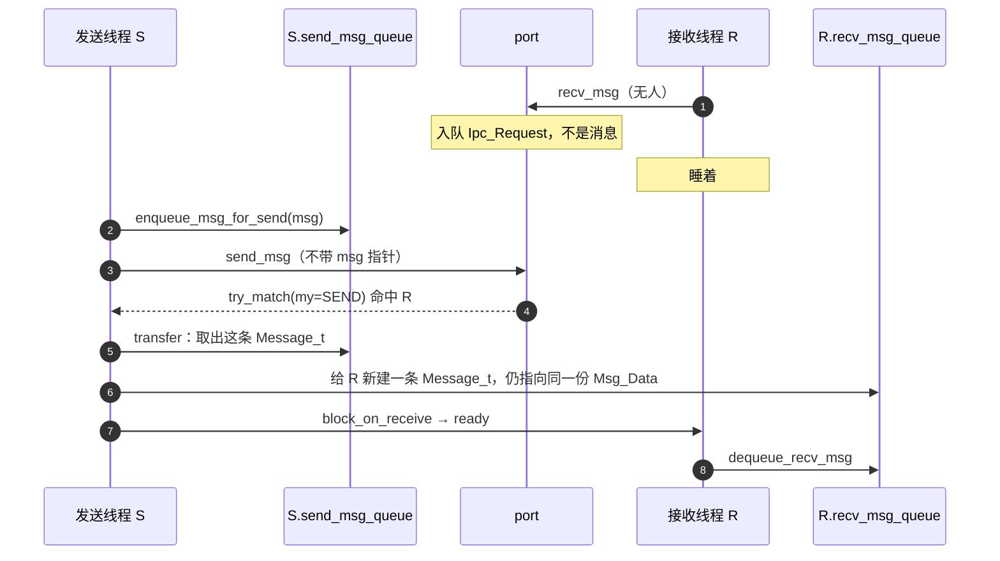
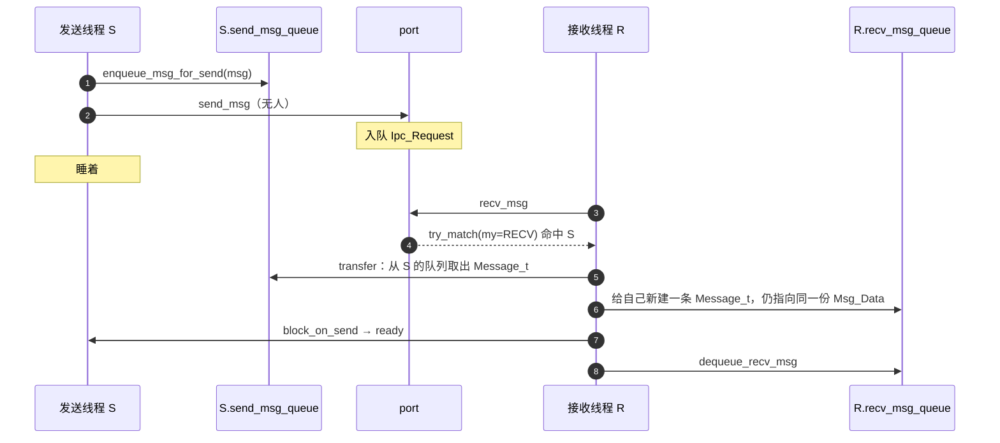
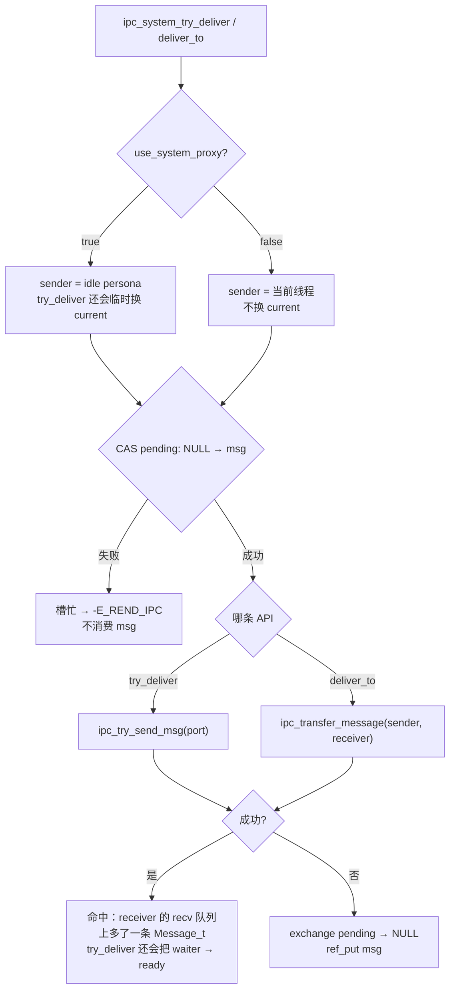

# 阻塞与非阻塞收发

v0.1 · 2026-10-02

本篇覆盖：`kernel/ipc/ipc.c`、`include/rendezvos/ipc/ipc.h`。

**建议先读** `18` **§1**（动机与 MSQ 约束；§1.2 末可跳本篇/`19`）与 `19`（两层对象），再读本篇。线程 status 与 `schedule` 见 `03-任务与调度/13-线程与Task_Manager.md`；`port_ops_begin/end` 与关闭 port 见 `22`；MSQ 会合队列细节见 `18` §2 起；system 异步投递见 `ipc.h` 注释（本篇 §6.6 摘要）。

---

## 1. 概述

从对象模型往下推，本篇写 **会合与投递怎么跑**。

收发仍是两步：**在 port 上配对线程**（使用 `Ipc_Request` 而非进程控制块在 `thread_queue` 中排队），再 **`ipc_transfer_message` 投递消息**（用 `Message_t`而非简单的消息封装 `Msg_Data_t`在发送方和接收方的队列中排队，新建对方的 `Message_t`、收发双方的 `Message_t`共享同一份 `Msg_Data_t`，图和基于假出队导致的这种设计原因在 `18` §1.5）。

**阻塞收发接口**（`send_msg` / `recv_msg`）：port 上没有对端就挂进 `thread_queue`，标记线程为 `block_on_send` / `block_on_receive`，然后 **`schedule`** 走。当消息完成发送不再阻塞之后，会由对端唤醒并随后返回。

**非阻塞收发接口**（`ipc_try_*`）：只 try_match；对不上就 `-E_REND_AGAIN`，不阻塞。当然，发送大量消息时，更为靠谱的方式是我们绕过线程配对的过程，在最开始进行一次配对，获取消息对端的引用，然后之后全程用**`ipc_transfer_message`**直接发消息，接收双方都有队列缓冲，加上本篇所说的推拉收发操作，所以实际上可以一直发。

对于阻塞收发调用方：发送方先 `enqueue_msg_for_send` 再 `send_msg`；接收方 `recv_msg` 再 `dequeue_recv_msg`——「放消息 / 取消息」与「会合传送」解耦（`19` §1.1）。状态机、推拉时序与实现循环见 §6。

### 1.1 谁跑 transfer——推还是拉？

阻塞路径里，**一定是一侧睡在 port 上，另一侧来配对**。按照我们的设计，来配对且配对成功的那一侧，顺手跑 `ipc_transfer_message`：

- 已有人在 recv 上等，你 `send_msg` 配对成功，则是 **sender 推**（transfer 跑在 sender 核上）。
- 已有人在 send 上等，你 `recv_msg` 配对成功，则是 **receiver 拉**（transfer 跑在 receiver 核上）。

不是「只推」或「只拉」，而是 **推拉平衡**：谁没阻塞在 port 上，谁干活。跨核时「拷贝消息的代码跑在哪颗核」要心里有数。exit race / 发送方在`ipc_transfer_message`中失败导致已经有消息出队但是没有送达，不得不使用 `send_pending_msg` 等边缘场景的处理见 §6.5；场景时序图见 §6.0。IRQ 也作为一个消息发送，但是不走 `enqueue`，见 §6.6。无锁会合上的阻塞只表示「在等对手」，**不**等于会合队列上加了大锁（`18` §1.1）。

### 1.2 假出队如何导致 `Ipc_Request` 在 `thread_queue` 中排队而非TCB

Port 上排队的必须是 **每次会合新分配的 `Ipc_Request_t`**，不能把 TCB 嵌进 MS 节点，假出队会让刚匹配的节点仍当 dummy，再次 enqueue 会自环（详 §4.1；假出队因果见 `18` §1.4）。这也是拒绝通用 `cancel_ipc` 的根因之一（§6.7）：队上可能存在多个 request（其中包括dummy的request），按 TCB 反查requeust带来的无锁边界情况处理，代价非常高昂。

---

## 2. 目标与边界

**提供：** 不包括准入判定的会合式收发与消息转移；阻塞与 try 两套入口；IRQ / timer 用的 system 异步投递。承接`18`，`19`相关内容。

**不做：** Port / Message 对象创建与注册（`19`）；MSQ CAS 细节（`18`）；RPC 状态机、reply port 命名、超时（兼容层应当自行处理）；多消息批处理；跨 port 自动路由；在 `send_msg` 内替 caller 构造 `Message_t`（须先 `enqueue_msg_for_send`）。

---

## 3. 分层与调用方

**Server 线程** — 先 `create_message_port`，再 `register_port`，一直握着 create 拿到的那份 `Message_Port_t*`（不要每轮 `thread_lookup_port` 自己创建的port）。循环：`recv_msg(port)`，成功则 `while (dequeue_recv_msg())` 弹出消息，然后处理并 `ref_put(msg)`。不再服务时先 `unregister_port`，再 `ref_put(port)`（编排见 `19` §6.1）。

**Client 线程** — `thread_lookup_port` 按名拿到对端 port（自带一份引用，并存入cache），再 `create_message_*` / `enqueue_msg_for_send` / `send_msg`，发送完 `ref_put(port)`；reply 侧另建 recv 循环或 try_recv。

**Boot 线程** — `kernel_handle_msg` 对 `KERNEL_PORT_NAME` 阻塞 recv 用于收取发给内核的消息（见模块初始化篇）。

**IRQ / timer** — 不用 `send_msg` 阻塞路径；用 `ipc_system_try_deliver` / `ipc_system_deliver_to`（§6.6），因为内核的中断情形下本不应该阻塞，不然会出问题，同时借用idle的收发队列表示这是内核发送的。

须遵守：
- lookup / create 拿到的每一份 port 引用都要配对 `ref_put(..., free_message_port_ref)`；
- `send_msg` / `recv_msg` 前 port 须已 `register_port`（`ops_life==REGISTERED`）；
- 关闭中的 port 返回 `-E_REND_PORT_CLOSED`。
- 阻塞在 port 上时如果被 `unregister` 清理队列唤醒：**send / recv 两侧的通知方式不同**（结论表见 `19` §3）——send 侧恒带 `THREAD_FLAG_IPC_PORT_CLOSED`；recv 侧优先投 `KMSG_OP_SYSTEM_PORT_CLOSED`，仅投递失败（`recv_pending_cnt` 仍为 0）才打同一 flag。

---

## 4. 数据结构与不变量

### 4.1 Ipc_Request_t

```c
typedef struct {
        ms_queue_node_t ms_queue_node;
        Thread_Base* thread;
        ms_queue_t* queue_ptr;
} Ipc_Request_t;
```

**为何排队的是 request，不是 TCB？** 原因见本篇 §1.2 与 `18` §1.4。简要说：匹配弹出后旧 dummy 被 put，对端节点仍可能留在队里当新 dummy。若把 `Thread_Base` 嵌进 MS 节点，被 match 唤醒的线程再次 `enqueue_wait` 时，会把仍挂在队上的同一节点再入队，形成**自环**，队列损坏。

因此每次阻塞会合都 **新分配** 一个 `Ipc_Request_t` 入队——节点只代表「这一次等待」，不是线程本体。这和 transfer 时「new 一条 `Message_t`、对共享的 `Msg_Data_t` 做 `ref_get`」不是一回事（消息层，见 `19` §1.3）；request 侧没有「复制一份 request」。

生命周期要拆成**两套**引用计数（别混）：

**A. `thread->refcount`（保证 `req->thread` 不野）**

| | 何时 | 代码 |
|--|------|------|
| **+1** | 创建 request | `create_ipc_request`：`ref_get_not_zero(&thread->refcount)` |
| **-1** | request **结构体真正回收** | `delete_ipc_request`：`ref_put(&thread->refcount, …)` |

同一条 request 上，中间不会再对 TCB 额外 get/put。引用单向：只有 request → thread；TCB **不**回指 request（避免循环 ref）。

**B. `req->ms_queue_node.refcount`（MSQ 节点本身；归零才回收 request）**

| | 何时 | 说明 |
|--|------|------|
| **起点 +1** | `create_ipc_request`：`ref_init` | 创建方先握 1 |
| **入队** | `msq_enqueue_check_tail` | 队列再 get；成功后创建方立刻 `ref_put`（此后通常只剩队列持有） |
| **出队 / 配对** | `msq_dequeue_check_head` | 交给配对方的节点已带 1 份引用 |
| **用完 -1** | 配对成功、丢掉陈旧 request、或 `port_clean_thread_queue` | 各路径 `ref_put(..., free_ipc_request)` |
| **假出队** | 逻辑弹出后节点常仍当队头 dummy | 队列侧可能还握着引用；**不是**配对当下就拆掉结构体 |

节点 refcount 归零时，`free_ipc_request` **不立刻 free**：先 `ebr_retire_ref`（见 `17`），安全后再 `free_ipc_request_real` → `delete_ipc_request`。因此 **TCB 的那次 -1 落在 EBR reclaim 之后**，可能晚于「已经 match / 线程已醒」；在此之前 `req->thread` 一直有效。

### 4.2 线程侧 IPC 字段（与本篇相关）

| 字段 | 作用 |
|------|------|
| `send_msg_queue` | 待发送消息 MSQ |
| `recv_msg_queue` | 已到达消息 MSQ |
| `send_pending_msg` | 已从 send 队列取出但尚未成功 transfer 的单槽（push race / system deliver） |
| `recv_pending_cnt` | 逻辑到达计数；投递成功会递增，`dequeue_recv_msg` 弹出后递减 |
| `port_ptr` | 阻塞在 port 上时非 NULL；match 时 CAS 清掉 |

### 4.3 Port 队列状态 tag

会合队列是**单状态**的：同一时刻要么全是 SEND 等待者，要么全是 RECV，要么空（只有 dummy）。状态记在 `thread_queue` **tail** 的 tagged pointer 低位（`IPC_PORT_APPEND_BITS == 2`），由 `ipc_get_queue_state` 读出：

| 常量 | 值 | 含义 |
|------|----|------|
| `IPC_PORT_STATE_EMPTY` | 0 | 空（无数据节点） |
| `IPC_PORT_STATE_SEND` | 1 | 队里全是发送等待者 |
| `IPC_PORT_STATE_RECV` | 2 | 队里全是接收等待者 |

带状态的入队出队算法细节见 `18` §1.7 / §6.3。本篇关心 **IPC 两侧怎样用这个状态**：

**入队 — `ipc_port_enqueue_wait` → `msq_enqueue_check_tail`**

先读当前态，再决定 `expect`（tail 必须仍是这个态）和写入的 `append_info`（`my_ipc_state`）：

| 当前态 | 本线程角色 | 行为 |
|--------|------------|------|
| EMPTY | SEND 或 RECV | expect=`EMPTY`，入队并把 tag 写成自己的态 |
| 与自己相同 | 同侧继续等 | expect=该态，入队，tag 保持该态 |
| 与自己相反 | 应对端已在等 | **不入队**，直接 `-E_REND_AGAIN`（外层应再走 try_match） |

`msq_enqueue_check_tail` 在挂链前核对 tail 的 append；对不上（发生了并发问题，其他核心已经操作并修改了状态）同样返回 `-E_REND_AGAIN`，供 `send_msg` / `recv_msg` 重试。

**出队 / 配对 — `ipc_port_try_match` → `msq_dequeue_check_head`**

匹配方要找的是**对侧**角色，不是自己：

| 本线程 | `expect`（对侧） |
|--------|------------------|
| SEND | `RECV` |
| RECV | `SEND` |

`msq_dequeue_check_head`还包含一个check_field_mask字段，用 `MSQ_CHECK_FIELD_APPEND` 查的是队头后第一个**数据节点** `next` 的 append，而不是口头读一下 `ipc_get_queue_state` 就完事。对不上 → 返回 none（本轮没配上）；对上则假出队，交给调用方握着那份节点引用。弹出**最后一个**数据节点时，MSQ 会把 tail 的 append 清回 `EMPTY`（见 `18` §6.3）。

陈旧 request（比如线程的 status / `port_ptr` 不符合期望但request仍在队列里面）在 `try_match` 里会 put 掉再取下一个，出队逻辑仍受同一套 tag 约束。关闭时清理队列走的是普通 `msq_dequeue`（`port_clean_thread_queue`），**不**按 SEND/RECV 过滤。

### 4.4 不变量

- 阻塞路径：**`schedule` 之前必须先 `port_ops_end`。** `port_ops_begin` 会把 `ops_count++`；`unregister_port` 要等 `ops_count==0` 才能清 `thread_queue`。若入队成功后带着未配对的 begin 去睡，本线程占着 count，关闭方会一直等不到，双方都卡住。因此 enqueue 成功后先 `end` 再 `schedule`；try 路径在返回前也会 `end`（不睡觉，但仍须放下 count）。详情见 `22` / `19` §4.1。
- 一次成功的 blocking send / recv 保证至少一条 message 已进入 receiver 的 recv 队列（caller 须 `dequeue_recv_msg`）。

---

## 5. 代码对应

| 符号 | 职责 |
|------|------|
| `ipc_port_try_match` | 从 port MSQ 找对手 Ipc_Request；status / `port_ptr` 不合格则丢弃再取下一个（§6.1） |
| `ipc_port_enqueue_wait` | 当前线程入 port 等待队列 |
| `ipc_transfer_message` | 从 sender 向 receiver 转移一条 message |
| `send_msg` / `recv_msg` | 阻塞会合 + transfer |
| `ipc_try_send_msg` / `ipc_try_recv_msg` | 非阻塞 try_match + transfer |
| `enqueue_msg_for_send` | 消息入当前线程 send 队列 |
| `dequeue_recv_msg` | 从 recv 队列取 message（隐藏 dummy 语义） |
| `ipc_drop_one_orphan_send_msg` | 关闭 port 或 send 失败时清理 send 侧孤儿消息 |

---

## 6. 流程

### 6.0 一次会合：分叉与推拉时序

本节只放**概念图**。

| 图 | 回答什么 |
|----|----------|
| 图 1 ASCII | 以 send 为例（ recv 骨架类似）：成功走 transfer / 失败在阻塞模式睡以及睡醒后收尾 / 非阻塞模式的 try 和失败整体的框架如何 |
| 推拉分别如何实现 | 谁先到 port 决定谁来跑 `ipc_transfer_message`（推还是拉）；这与图一的阻塞非阻塞时正交的两个方面 |

#### 图 1：阻塞 vs 非阻塞（以 send 为例）

`port_ops_begin` 之后 `try_match`：找到对端则 transfer；未找到则若是阻塞式的 `send_msg` 入port队列睡觉，或非阻塞的 `ipc_try_send_msg` 立刻 `-E_REND_AGAIN`（消息仍在本线程 send 队列）。阻塞情况下，醒后看 `THREAD_FLAG_IPC_PORT_CLOSED`是否置位，如果对端配对成功那么应当没有这个 flag 并 SUCCESS。如果是因为 port 的 `unregister` 清理队列则有 flag，需要清理 drop orphan 并返回 PORT_CLOSED。recv 骨架是类似的；transfer 失败码不对偶见 §6.3。

```text
                         ┌──────────────────┐
                         │port_ops_begin    │
                         │(SEND)            │
                         └────────┬─────────┘
                                  ▼
                         ┌──────────────┐
                         │  try_match   │
                         └──────┬───────┘
                 ┌──────────────┼──────────────────┐
                 │命中 RECV      │未命中·阻塞         │未命中·非阻塞
                 ▼              ▼                  ▼
        ┌────────────────┐ ┌─────────────────┐ ┌──────────────────────┐
        │ipc_transfer_   │ │blocking send_msg│ │non-blocking          │
        │message         │ │block_on_send +  │ │ipc_try_send_msg      │
        │→ SUCCESS       │ │enqueue          │ │port_ops_end → AGAIN  │
        └────────────────┘ │port_ops_end →   │ │(消息仍在 send 队列)   │
                           │schedule（睡）    │ └──────────────────────┘
                           └────────┬────────┘
                         ┌──────────┴──────────┐
                         │                     │
                         ▼                     ▼
              ┌──────────────────┐   ┌──────────────────┐
              │ 对手 match 并     │   │ unregister 清理队列   │
              │ transfer，唤醒本端 │   │ 唤醒本端          │
              └────────┬─────────┘   └────────┬─────────┘
                       └──────────┬───────────┘
                                  ▼
                    ┌─────────────────────────────┐
                    │ 醒后看 THREAD_FLAG_          │
                    │ IPC_PORT_CLOSED             │
                    └──────────────┬──────────────┘
                         ┌─────────┴─────────┐
                         │有 flag            │无 flag
                         ▼                   ▼
              ┌──────────────────┐   ┌──────────────────┐
              │ drop orphan      │   │ SUCCESS           │
              │ → PORT_CLOSED    │   │ （对手已 transfer）│
              └──────────────────┘   └──────────────────┘
```

#### 场景 A / B：推 vs 拉（谁跑 transfer）

图 1 讲阻塞还是非阻塞的try；这里讲 §1.1 的推拉：对端已睡在 port 上时，后来者配对成功，transfer 跑在后来者核上。要求两端都走阻塞 API。

下面用S表示发送者（sender），R表示接收者（receiver）。

**场景 A（推）：** R 先睡；S 后来配对找到 R → **S 推** transfer，再把 R 设置为 ready。对应图 1 左侧「命中 → transfer」。



**场景 B（拉）：** S 先睡；R 后来配对找到 S → **R 拉** transfer，再把 S 设置为 ready。与 A 对偶；S 醒后走图 1 下半「对手 transfer」支路（无 `PORT_CLOSED`）。



实现上的 `while`、失败码、try 路径见 §6.2–§6.4（调用方须先 `enqueue_msg_for_send`，§6.6 system 封装除外）。

### 6.1 `ipc_port_try_match`：对端不合格就丢掉再取下一个

`try_match` 不是「dequeue 一次就交给调用方」。它对 `thread_queue` 循环 `msq_dequeue_check_head`，每次取出一个 `Ipc_Request_t` 后还经过两个验证（`ipc.c`）：

1. **status 必须仍是期望的阻塞态**（本侧 SEND 时对头须 `block_on_receive`；本侧 RECV 时对头须 `block_on_send`）。如果不匹配：试图 CAS 清线程的 `port_ptr`，然后 `ref_put` 掉这个 request，继续取下一个。这就是「陈旧 waiter」——线程已经不在这次会合上了，状态已经发生改变（比如线程 exit、被清理出队列、状态被改过），节点却还留在 MSQ 里（假出队 / 关闭竞态）。由于 MSQ 过于复杂没有设计 `cancel_ipc`，只能靠这条路径把它们丢掉。
2. **`port_ptr` 的 CAS 必须把 port 写成 NULL 才算成功**。失败同样 put request 再 continue，因为可能这个线程在改完状态之后又进了另外一个队列，而如果这样，`port_ptr`会指向另一个队列，如果直接修改为NULL，会导致信息丢失，下次出队出问题。

两道都过才把 request 交给 `send_msg` / `recv_msg` / `ipc_try_*`。队列空或 tag 对不上则返回 NULL，由上层决定阻塞还是 `-E_REND_AGAIN`。

### 6.2 send_msg（阻塞）

图 1 中间支路的实现：`ipc.c` 里的 `while`、各类失败码与重试相关伪代码写在这里。

```text
port_ops_begin(SEND)
  loop:
    try_match(RECV 侧对手)?
      yes → ipc_transfer_message(me, peer)
            SUCCESS：peer block_on_receive → ready；ops_end；SUCCESS
            AGAIN：receiver 正在 exit → ref_put request，指针置空，再 try_match
                   （消息在 send_pending_msg）
            其它：ops_end；按码返回
      no  → status = block_on_send
            enqueue_wait
            成功：ops_end → schedule
                  醒后若 PORT_CLOSED → drop orphan，-E_REND_PORT_CLOSED
                  否则 SUCCESS（对手已 transfer）
            enqueue 冲突 -E_REND_AGAIN → 恢复 status，重试 loop
            enqueue 其它错误 → 恢复 status，ops_end，-E_RENDEZVOS
```

要点：

- try_match 成功时由 **sender** 跑 transfer；receiver **不**在此路径 `schedule`（只被改成 ready；真正再跑是它自己的 recv 返回或之后某次被调度器选中）。
- enqueue 成功后当前 sender 睡眠，直到对手 match 并完成 transfer。

### 6.3 recv_msg（阻塞）

骨架同图 1 / §6.2（场景 B：R 拉）。本节只写**不能照抄 send** 的两处：transfer 失败的 `switch`，以及关 port 醒后的处理。

| `ipc_transfer_message`返回结果 | `recv_msg` 怎么处理 | 为何 |
|------------------------|-------------------|------|
| `REND_SUCCESS` | sender 从 `block_on_send` 变成 `ready`；SUCCESS | 拉成功 |
| `-E_REND_NO_MSG` | `continue`（不 `ref_put`、不清空 `sender_request`，不会再 try_match） | sender 队列空或 sender 正在 exit；注释写换 sender，实现未换 |
| `-E_REND_AGAIN` | `ref_put` request；**返回 `-E_RENDEZVOS`** | 这事儿不可能：AGAIN 只在 **receiver** 正在 exit 时产生，而跑这段代码的就是 receiver |
| 其它 | 按码返回 | |

不要把 §6.2 的「AGAIN 就 put 再 match」抄到 recv 上。enqueue 冲突仍是恢复 status 再 loop；enqueue 其它错误同样 `-E_RENDEZVOS`。

**关闭 port 后醒来时，send / recv 的等待者处理不同**（具体理由在 `port_clean_thread_queue` ；**为何**不对称见 `19` §6.2「为何不对称」，因为send 醒在 errno/orphan 路径，recv 醒在「dequeue 一条消息」路径）：

| 醒后条件 | `recv_msg` 返回 | 调用方 |
|----------|-----------------|--------|
| `THREAD_FLAG_IPC_PORT_CLOSED` | `-E_REND_PORT_CLOSED`（清 flag；**无** orphan 路径） | 无消息可 dequeue（投递 closed-kmsg 失败时的兜底） |
| 无 flag（通常已投上 PORT_CLOSED kmsg） | `REND_SUCCESS` | **必须** `dequeue_recv_msg`；以 `kmsg_from_msg` + opcode 识别 port 已关闭 |

Send 侧醒后：有 flag 则 drop orphan 并返回 `-E_REND_PORT_CLOSED`；无 flag 则 `REND_SUCCESS`（对手已 transfer）。关闭路径上 send **总是**带 flag（从不靠 kmsg）。

### 6.4 ipc_try_send_msg / ipc_try_recv_msg

本小节描述的是图 1 右侧支路。源码里带 `while (1)`，但匹配不到 port 对端不会继续：

- `try_match` 得到 NULL 则立刻 `port_ops_end` 并返回 **`-E_REND_AGAIN`**（消息仍在 send 队列；recv 侧无消息）。
- 循环只在 **已经 match 到对端、但 transfer 还没做成** 时继续：try_send 对 transfer 返回 `AGAIN` 先 `ref_put` 再清空指针、然后做下一圈 `try_match`；try_recv 对 `-E_REND_NO_MSG` 继续循环（不换 `sender_request`，见 §6.3）。try_recv 若看到 transfer 返回 `AGAIN`，与阻塞 recv 一样返回 **`-E_RENDEZVOS`**。
- 不把调用者改成 block 状态（match 成功时只改对端的 status）。
- 适用于兼容层使用 poll模式，以及 §6.6 的 `ipc_system_try_deliver`（内部就是 `ipc_try_send_msg`）。

### 6.5 ipc_transfer_message 要点

图解（新建 `Message_t`、共享 `Msg_Data`）见无锁篇 §1.5。本节讲 **`send_pending_msg` 为什么存在**，以及 transfer 里几类竞态怎么收。

#### `send_pending_msg` 是什么

每个线程上有一个**单槽**指针 `send_pending_msg`：存放「已经从 `send_msg_queue` 取出（或由 system 路径直接塞进槽）、但还没有成功交给一个仍存活的 receiver」的那条 `Message_t`。

没有这个槽会怎样：transfer 必须先 dequeue 才能 new 接收方节点；若此时发现 receiver 正在 `exit`，消息已经离开 send 队列、又不能投递。如果直接丢；上层 `AGAIN` 重试时队列头已是下一条，**当前这条就没了**。单槽`send_pending_msg` 指针把「半截 transfer」的消息停在 sender 这边，下次 `ipc_transfer_message` 优先从这里取，而不是再 dequeue。

谁写这个槽：

| 写入方 | 场景 |
|--------|------|
| `ipc_transfer_message` 自己 | sender 推：enqueue 到 recv 后发现 receiver 已 exit → CAS 把消息放回`send_pending_msg`，返回 `-E_REND_AGAIN` |
| `ipc_system_*`（§6.6） | IRQ / timer 不走 `enqueue_msg_for_send`，直接 CAS 进槽再 try 发送 |

正常成功路径上`send_pending_msg`应为 NULL；同一时刻**至多一条** 停在`send_pending_msg`里。

#### 要防的几类竞态（对应 `ipc.c` 注释 Problem 1–4）

| # | 场景 | 危险 | 做法 |
|---|------|------|------|
| 1 | **Sender 推**：已 dequeue，receiver 正在 exit | 消息悬空 / 被丢 | 放回 `send_pending_msg`，返回 `-E_REND_AGAIN`；上层换下一个 waiter 再 transfer（**不要**对同一条 exit 中的 request 再试） |
| 2 | **Receiver 拉**：sender 同时正在exit，可能把 `send_pending_msg` 清掉 | 若只靠`send_pending_msg`指针，消息会丢 | 一进来就 `exchange(pending, NULL)` 到**栈上局部** `send_msg`；之后 sender 清槽也不影响本次投递 |
| 3 | 多个 receiver 同时 pull，却只有一个 pending 槽 | 理论上槽争用 | 现行会合是一对一 match；sender 推路径上「只有一个 sender」在写回槽。 |
| 4 | MSQ 假出队 | 不能把仍当 dummy 的节点直接挂到 recv 队列 | 接收方 **new** 一条 `Message_t`，`fill_message_data` 共享同一份 `Msg_Data_t` |

推 / 拉谁跑 transfer 见 §6.0；这里有个关键性的原则**谁跑函数，谁必须活着**：receiver 拉时不可能「自己正在 exit」还跑到写回 pending；sender 推时才需要处理「对端 exit」。

#### 伪代码（对齐现行 `ipc_transfer_message`）

```text
ipc_transfer_message(sender, receiver):
    if receiver.status == exit:
        return AGAIN          // 尚未动队列

    recv_node = create_message_structure()
    if fail: return ERROR

    // —— 取得一条待发送的 Message_t，所有权进局部 send_msg（迁移语义，不必再 ref_get） ——
    send_msg = atomic_exchange(&sender->send_pending_msg, NULL)
    if send_msg == NULL:
        send_msg = msq_dequeue(sender->send_msg_queue)
        if 空:
            delete(recv_node); return NO_MSG
        if sender.status == exit:          // pull 时 sender 已走
            ref_put(send_msg); delete(recv_node); return NO_MSG

    // —— 接收侧新节点 + 共享 Msg_Data，入 recv 队列 ——
    fill_message_data(recv_node, send_msg->data)   // Msg_Data ref_get
    msq_enqueue(receiver->recv_msg_queue, recv_node)
    ref_put(recv_node)                             // 队列持有
    receiver->recv_pending_cnt++

    if receiver.status == exit:                    // 仅 sender 推会落到这
        // 消息已出现在 exit 中的 recv 队列上；待发送的 Message_t 放回槽供重试
        if CAS(&sender->send_pending_msg, NULL, send_msg) 失败:
            ref_put(send_msg); return ERROR        // 槽已被占用，丢这条
        return AGAIN                               // 上层换 waiter，勿再对同一 request transfer

    ref_put(send_msg)                              // 投递成功，sender 不再握这条 Message_t
    return SUCCESS
```

返回值上层怎么接（细节见 §6.2 / §6.3，此处只钉 transfer）：

| 返回 | 含义 | sender 推（`send_msg` / try_send） | receiver 拉（`recv_msg` / try_recv） |
|------|------|-----------------------------------|-------------------------------------|
| `SUCCESS` | 已入 recv 队列 | peer 从 `block_on_receive` 变成 `ready`；ops_end | sender 从 `block_on_send` 变成 `ready`；SUCCESS |
| `AGAIN` | receiver 正在 exit；待发送消息停在 `send_pending_msg` | put request，再 `try_match` | 源码认定不应出现 → `-E_RENDEZVOS` |
| `NO_MSG` | 没有可发送的消息（队列空，或 pull 时 sender 已 exit） | 按码返回 | `continue`（不换 request，见 §6.3） |

成功时：sender 侧那条 `Message_t` 被 put；receiver 侧是新节点，两边 `Message_t.data` 指向同一 `Msg_Data_t`。`try` 与 blocking 在 `ipc.c` 是分支拷贝，不要想当然合并。

### 6.6 System 封装：IRQ / timer 不能直接 `send_msg`

Timer / 设备 IRQ **没有合法的「发送者线程」**。若在 IRQ 里调 `get_cpu_current_thread()` 再 `enqueue_msg_for_send` + `send_msg`：

1. 消息会进**被打断的线程**的 `send_msg_queue`；
2. `ipc_transfer_message` 永远从队列**头**取（或 `send_pending_msg`），不是「刚入队的那条」；
3. 被打断线程醒来时，自己的 send 语义已被污染。

因此 system 路径**禁止** `enqueue_msg_for_send`，也**禁止**阻塞 `send_msg`（IRQ 里 `schedule` 会把整机卡住）。改走单槽 staging + **try 发送**：

| API | 模式 |
|-----|------|
| `ipc_system_try_deliver(port, msg, proxy)` | CAS 把 `msg` 写入选定 sender 的 `send_pending_msg`，再调 **`ipc_try_send_msg(port)`**；经 port 会合。无 waiter 则 `-E_REND_AGAIN`，再 try-clean 槽 |
| `ipc_system_deliver_to(receiver, msg, proxy)` | staging 后直接 `ipc_transfer_message(sender, receiver)`，**无** port 会合 |

`use_system_proxy`：

| 值 | 含义 | 典型 |
|----|------|------|
| **true** | 暂用 **idle** 当 `current_thread`（persona，即临时借用 idle 线程身份作为「发送者」），跑完再换回 | Timer **EXPIRE**（IRQ） |
| **false** | 用真正的当前线程；**不**换 persona；仍只 staging、不 enqueue | Timer **CANCEL**（线程上下文） |

`ipc_system_*` **不是**第三套会合模型，而是对上面骨架的封装：先选 sender，把 `Message_t` 放进 `send_pending_msg`，再调已有的 `ipc_try_send_msg` 或 `ipc_transfer_message`。下图只画这一层封装（sender 用谁、pending 怎么进、失败怎么清），不重画 §6.0 的两个线程。


读图：两条 API 共用「选 sender + CAS pending」。

`try_deliver` 接到 **`ipc_try_send_msg`**（还要 port 上有人在 recv，等价于 §6.0 场景 A 的 try 版）。

`deliver_to` 跳过 port，直接 **`ipc_transfer_message`**。失败都走右边 `CLEAN`，不要把消息留在 pending 里。`deliver_to` **不**换 `current_thread`（即使 `proxy=true` 也只用 idle 当 sender）。关 port 清理队列时注入 `PORT_CLOSED` 也走 `deliver_to`，不限于 timer。

**例子：定时器到期为什么必须用 try，不能排队。**

假设线程 T 要「等到点再继续」：

1. T 先在约定的 port 上调用阻塞 `recv_msg`，睡着，从而让 port 上已经有一个 RECV 等待者。
2. 硬件定时器到期，进入 **IRQ**：这里不能 `schedule`，也不能往「当前被打断的线程」的 send 队列里塞消息（见本节开头）。
3. IRQ 里只做一件事：`ipc_system_try_deliver(port, 到期消息, proxy=true)`——借用 idle 当发送者，把消息放进 `send_pending_msg`，再调 **`ipc_try_send_msg`**。
4. **若 T 还在 port 上睡**：try 命中 T，transfer 成功，T 被打成 ready，稍后 `dequeue` 到到期消息。
5. **若 T 已经不在了**（提前醒、已经 cancel、token 失效）：port 上没有 RECV 对手，try **立刻**返回 `-E_REND_AGAIN`，再把 `send_pending_msg` 清掉并 `ref_put` 这条消息。  
   这是预期行为：IRQ **不会**替你在 port 上挂一个 SEND 等待者——挂了就要睡，IRQ 里睡不得。

所以「try 发送」= 对面有人就投，没有人就失败并丢掉这次投递；和阻塞 `send_msg`（没人对面就自己睡进队列）相反。上层用 `delivery_token` 区分「这是不是我还在等的那一次到期」。port 引用与 EXPIRE 失败是否 `fini`，见时间篇 `33` / `time.c`（现行：成功 EXPIRE 才 `fini`；失败则短延时再试）。

关闭 port 清理队列时，也会给 recv 等待者注入 `PORT_CLOSED` 消息走 **`deliver_to`**，所以这个操作并不限于 timer 等IRQ路径。

**刻意没有** `ipc_system_try_recv`：Boot线程作为一个普通线程代行内核收消息的职能，但是并不需要额外的框架

### 6.7 不做 `cancel_ipc`

没有、也不计划「按线程从 port MSQ 强制 dequeue」的 API。原因：

1. 队上挂的是多个 `Ipc_Request_t`，按 TCB 定位代价高且与假出队/EBR 耦合。
2. 阻塞常态常常只有一侧各一人在等——**取消发送**：对端任意收一条再丢弃；**取消接收**：发一条约定 cancel / 关闭协议消息即可。
3. 定时器取消已有专用路径：`rendezvos_timer_event_cancel` 内部调 `ipc_system_try_deliver(..., false)`（见时间篇），不必通用 cancel。

兼容层若要「打断阻塞 syscall」，用协议消息 / 关 port / 专用 cancel opcode，不要假设存在 Linux 式 `cancel_ipc`。

---

## 7. 公开 API

本篇涉及的接口分布在：`ipc.h` / `ipc.c` 的会合式收发、transfer、enqueue/dequeue、system 异步投递。说明以头文件注释为准。

**本篇不涉及：** port 创建/注册见 `19`；`port_ops_begin`/`ops_allow` 深挖见 `22`；MSQ CAS 见 `18`；EBR 见 `17`。

`ipc_port_try_match` / `ipc_port_enqueue_wait`：**内部**（`ipc.c` static）；不要当作公开 API。

### 7.1 编排顺序（调用方须遵守）

| 场景 | 顺序 |
|------|------|
| 阻塞发送 | 创造一条消息（`19`），再 **`enqueue_msg_for_send`**，接着 **`send_msg(port)`**（成功则消息已在对面） |
| 阻塞接收 | **`recv_msg(port)`**，再 **`dequeue_recv_msg`**，用完 `ref_put(..., free_message_ref)` |
| 非阻塞 | 同上，但用 **`ipc_try_send_msg` / `ipc_try_recv_msg`**；无对端则 `-E_REND_AGAIN`（send 时消息仍在本线程 send 队列） |
| IRQ / timer 投递 | **勿** `enqueue_msg_for_send`；用 **`ipc_system_try_deliver`**（port 会合）或 **`ipc_system_deliver_to`**（已知 receiver） |

推拉：配对成功且未睡在 port 上的一侧跑 `ipc_transfer_message`（见 §6.0）。

### 7.2 线程收发

```c
error_t enqueue_msg_for_send(Message_t *msg);
error_t send_msg(Message_Port_t *port);
error_t recv_msg(Message_Port_t *port);
error_t ipc_try_send_msg(Message_Port_t *port);
error_t ipc_try_recv_msg(Message_Port_t *port);
Message_t *dequeue_recv_msg(void);
error_t ipc_transfer_message(Thread_Base *sender, Thread_Base *receiver);
```

| 接口 | 说明 |
|------|------|
| `enqueue_msg_for_send` | 挂到当前线程 `send_msg_queue`；无 current 则 `-E_REND_AGAIN`；refcount 坏则 `-E_REND_IPC`。 |
| `send_msg` | `port_ops_begin(SEND)`；try_match 命中则 transfer（推），否则 `block_on_send`+enqueue+**先 end 再 schedule**。transfer `AGAIN`：`ref_put` + 置空 + 再 `try_match`。begin 失败 / 醒后见 `IPC_PORT_CLOSED` flag 则清 orphan，返回 `-E_REND_PORT_CLOSED`。 |
| `recv_msg` | 会合对偶；transfer 失败码见 §6.3（`AGAIN` 对应 `-E_RENDEZVOS`，不是重试）。成功后**必须** `dequeue_recv_msg`。关闭 port 后醒来：**无** flag 则 `REND_SUCCESS`（dequeue 识别 `KMSG_OP_SYSTEM_PORT_CLOSED`）；**有** flag 则 `-E_REND_PORT_CLOSED`（见 `19` §6.2）。 |
| `ipc_try_send_msg` | 同前置；无 receiver 则 `-E_REND_AGAIN`（不阻塞；消息仍在 send 队列除非自行取出）。match 后 transfer `AGAIN`：`ref_put` + 指针置空，再 `try_match`。成功则对方从 `block_on_receive` 变成 `ready`。 |
| `ipc_try_recv_msg` | 无 sender 则 `-E_REND_AGAIN`；transfer `NO_MSG` 继续循环（不换 request，见 §6.3）；transfer `AGAIN` 则 `-E_RENDEZVOS`。成功须 dequeue；对方从 `block_on_send` 变成 `ready`。 |
| `dequeue_recv_msg` | 隐藏 MSQ dummy；`recv_pending_cnt--`；调用方持有返回消息的引用。 |
| `ipc_transfer_message` | 高级：已配对后给 receiver 新建 `Message_t`、共享 `Msg_Data`。`-E_REND_AGAIN`（recv 在 exit，消息回 `send_pending_msg`）；sender-push 调用方须 put request 再 match，见 §6.2。`-E_REND_NO_MSG`。 |

### 7.3 System 异步（IRQ / trap）

```c
error_t ipc_system_try_deliver(Message_Port_t *port, Message_t *msg,
                               bool use_system_proxy);
error_t ipc_system_deliver_to(Thread_Base *receiver, Message_t *msg,
                              bool use_system_proxy);
```

| 接口 | 说明 |
|------|------|
| `ipc_system_try_deliver` | 经 port try_match 获取接收方；`msg` 进 `send_pending_msg` 再 `ipc_try_send_msg`。`use_system_proxy`：true=idle persona（可临时换 current）；false=当前线程。失败 try-clean put msg。 |
| `ipc_system_deliver_to` | 已经知道接收方，无 port 会合；直接 `ipc_transfer_message(sender, receiver)`。receiver 不必在 port 上阻塞。 |

单槽 `send_pending_msg`：同时只传递一条 system 的消息。另外，不要在 IRQ 里调阻塞 `send_msg`/`recv_msg`，必须使用这两个接口哦。

### 7.4 request节点操作（较少直接兼容层调用，通常是内部的操作）

```c
Ipc_Request_t *create_ipc_request(Thread_Base *thread);
void delete_ipc_request(Ipc_Request_t *req);
error_t free_ipc_request(ref_count_t *); /* EBR */
```

port `thread_queue` 上挂的就是这些节点（持有 thread 的引用），这几个主要就是request节点的生成和删除操作。不太可能被兼容层直接操作，应当属于内部，所以不做过多介绍。

---

## 8. 多架构

IPC 会合与转移 **arch 无关**。

---

## 9. 测试

- `modules/test/single_port_test.c` — 单 port 阻塞往返。
- `smp_*` 测试用例 — 多核 send / recv 压力。

```bash
cd core && make ARCH=x86_64 config && make run
```


---

## 10. 限制与后续

现行限制：

- **单消息 transfer** — 每次会合转移一条；要多条就上层循环 `enqueue` + send / try。
- **send_pending_msg 单槽** — 多 receiver 同时 pull 同一 sender 的 race 由 `ipc.c` 注释中的 Problem 约束；上层应避免。
- **无超时** — 阻塞直到 match 或 port close。
- **try 路径不保证 fairness** — 调度器若迟迟不调度对端，try 可能饥饿，兼容层需自旋或阻塞。

### 10.1 未实现的演进方向（现行代码不做）

下面四条来自设计笔记里「想过、现行代码不做」的部分。对象模型仍以 `19` 为准；实现或专篇 design 完成前见 `v0.1/evolution/TODO.md` **E2 / E4**。

**背压。** 环形队列靠容量硬顶：满了发送失败。本仓库 MSQ 无固定容量，core **不**另做流量窗口。阻塞 `send_msg` 在没有 receiver 取走 request 时把 sender 停住——这就是现在的隐式背压。走 try / 批量、放弃阻塞之后，就要上层用反向消息做反馈控制，不在 core 里做。

**批量、异步、函数调用式。** 都建立在已经暴露的 `ipc_transfer_message` 上。一种设想：控制线程仍用阻塞会合交换「数据线程指针」，之后双方绕过 port、直接 `enqueue` + `ipc_transfer_message`（甚至两边同时调）。异步再补线程状态；函数调用式则是 caller 发完就阻塞在自己的 recv 队列、callee 回一条。现行公开路径仍是「先会合再 transfer」；直接对任意 `Thread_Base*` 调 transfer 只留给 system `deliver_to` 这类明确入口（不要把 `send_msg` 改成可指定任意 sender）。

**广播。** 「一条消息叫醒这个 port 上所有 waiter」和现行 **单状态、一次 match 一条** 冲突（`19` §1.2、`18` §1.7）。v0.1 **明确不做**。

**调度器可感知的 IPC。** 临界区线程化之后，优先级翻转并没有消失：高优先级 A 等低优先级 B 的回复，B 被中优先级 C 抢走。enqueue 阻塞时若登记「A 依赖 B」，调度就可以先跑 B。这需要依赖图，也需要调度策略支持优先级 / 依赖（默认 `round_robin_schedule` 做不到）——与 **E4** 绑在一起，不是 IPC 单独能做完的。默认策略与可注入的 `scheduler` 指针见 `13`。

---

## 11. 变更记录

- 2026-10-17：Maintainer 审定——原则修正仅保留：recv/`try_recv` 对 `NO_MSG` 不换 request；§6.2 transfer「其它」去掉误写的 drop orphan。其余终检加料的表述已按 Maintainer 原文收回。README 第二格勾选。
- 2026-10-17：§6.0 删掉多余 flowchart；概念图（图 1 + 推拉 A/B）与实现（§6.2–§6.4）分工写清。
- 2026-10-17：§6.0 补全阻塞醒后双路（对手 transfer / unregister）与 flag 分支框；为阻塞·try 图与推拉 A/B 配读法说明。
- 2026-10-17：§4.3 补全状态 tag：enqueue（`enqueue_wait`）与 dequeue/配对（`try_match`）两侧如何用；清理队列不按态过滤；算法指 `18`。
- 2026-10-17：§4.1 在 Maintainer 改稿上润色；两套 refcount +1/-1 与 EBR 推迟仍保留。
- 2026-10-17：§3 Server 改为持有 create 的 port 循环 recv（不再每轮 `thread_lookup_port`）；关闭通知交叉引用改为 `19` §3。
- 2026-10-07：§1 概述瘦身——阻塞分叉 ASCII 与推拉 mermaid 迁入 §6.0，与实现 flowchart 合并；原 §6.0–6.6 顺延为 §6.1–6.7。
- 2026-10-05：§10.1 去掉 `lockfree-ipc` 旧路径外链；演进只指向 `v0.1/evolution/TODO.md`（E2 / E4）。
- 2026-10-09：开篇与阻塞/`schedule` 交叉引用对齐 `18` §1 新结构（不再声称「手动调度条件」写在 `18` §1.2）。
- 2026-10-05：§1.1 推/拉时序改为 mermaid sequence（一次发送从 `19` 挪到本篇）；ASCII 三栏错位不再用。
- 2026-10-05：`send_msg` / `ipc_try_send_msg`：transfer `AGAIN` 改为 put request 并再 `try_match`（与 `ipc.c` 一致）。§6 流程图 AGAIN 边回到 match。
- 2026-10-04：补推 / 拉时序对比图（§1.1）与阻塞 vs 非阻塞状态机 ASCII 图（§1 概述末）；口语动词「丢」改为「丢弃」。
- 2026-10-05：任务 1/3/5 精读——口语动词与翻译腔清理（不睡觉→不阻塞、拿到→取得、拿走→取出、毁掉→损坏、纠缠→耦合、随便→任意、勿想当然→不要想当然、勿当→不要当作、勿在→不要在、已在跑→已在运行、饿死→饥饿、touch→访问、标→标记为、摘→取出）；为首现缩写补全称/定义（RR、persona、staging、自环）；§9「测例」→「测试用例」。
- 2026-10-02：§1 按「18§1 → 18 → 本篇行为」重写：推拉、`Ipc_Request`、与假出队/图的推导链；§2 边界与 18/22 对齐。
- 2026-10-02：§4.1 假出队交叉引用改为 `18` §1.4（与 MSQ 四性质图节对齐）。
- 2026-10-02：§6.5 扩写 IRQ sender 问题与 proxy 语义；§6.6 写明拒绝 `cancel_ipc` 的理由与替代。（编号以当时稿为准；2026-10-07 后对应 §6.6 / §6.7。）
- 2026-10-02：§4.1 写清为何排队 `Ipc_Request` 而非 TCB（假出队自环）及拒绝双嵌入节点方案。
- 2026-10-01：§6.2 指向 `19`「为何不对称」；标明 send 关闭路径恒带 flag、recv flag 仅为 kmsg 投递失败兜底。
- 2026-09-27：中文表述润色（母语习惯）；`rendezvous` →「会合式收发」；「关港」改为「关闭 port」；「真源」改为「以…为准」；两侧通知差异表述更顺口。
- 2026-09-26：对照 `port_clean_thread_queue` / `recv_msg`：纠正「关闭 port 后醒来与 send 对称」——recv 优先 kmsg+SUCCESS，flag 仅投递失败；§3/§6.2/§7.2 与 `ipc.h` Doxygen 对齐；注明清理队列用 `deliver_to`。
- 2026-09-26：§7 全文审阅——`ipc.h` 补 Ipc_Request / send·recv 编排序与 PORT_CLOSED；写清 enqueue→send / recv→dequeue 与 system 双路径。
- 2026-09-25：语言整理；§6.1 改文字流程图（对照 `ipc.c`）；补 transfer race / IRQ 不可阻塞说明。
- 2026-08-29：§1 叙述：推拉平衡（谁没睡在 port 上谁跑 transfer）。
- 2026-08-27：初稿：阻塞 / try 收发、transfer、system deliver 摘要。
- 2026-10-05：最终词句顺畅。
